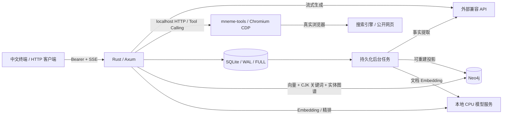

# mneme

以中文交流为主的单用户 AI 陪伴 Agent。Rust 核心提供多轮对话、SSE 流式回复、可配置人格和跨会话长期记忆。外部兼容 OpenAI Chat Completions 的服务负责生成与记忆提取；Embedding 和 Reranker 完全在本地 CPU 上运行。

第一版已经实现完整链路，不需要 Redis、消息中间件、APOC、GPU 或额外向量数据库。生产使用前须填写自己的外部 LLM 配置。当前实现面向一个可信用户；不要把同一个 Token 分发给多个互不信任的人。

## 架构



- SQLite 是事实源，保存原始消息、对话状态、记忆版本、证据原文和任务队列。完整回复与记忆任务在同一事务提交；进程中断不会丢失已提交任务。
- Neo4j 保存有效记忆及实体关系，提供 HNSW 向量索引、CJK 全文索引、实体直接匹配和两跳邻居扩展。候选经 RRF 融合、本地 Reranker 精排，再结合重要性和时间衰减。
- Neo4j 故障时，从最近 256 条有效 SQLite 记忆做有界向量/中文双字检索；模型故障时仍可用关键词。降级会在 API 中标记，不保证降级期间召回全部历史。
- 每个会话串行生成，跨会话最多同时 4 路。后台记忆使用单独工作协程。模型服务采用有界优先队列，查询与精排优先于待处理文档；一个进程加载两个模型，使用 3 个 CPU 推理线程。
- 本地模型使用 FP32、512 token 输入上限、小批量推理和 256 条有界 Embedding 缓存。模型权重、GTE 自定义代码均固定到 Git revision，只允许 safetensors。

`mneme-api` 编排对话和连续工具调用，`mneme-models` 保持本地模型推理职责，`mneme-tools` 执行浏览器操作。搜索通过真实网页输入与点击完成，不使用搜索 API；图片和截图交给现有外部多模态 LLM 理解。部署、限制与安全边界见 [docs/tools.md](docs/tools.md)。

模块和数据设计详见 [docs/architecture.md](docs/architecture.md)。

## Debian 13 部署

目标为 4C16G、无 GPU、Rootless Podman 5.4+、cgroup v2。建议至少留出 15 GB 磁盘用于镜像、构建缓存、模型及数据；对话和记忆随使用继续增长。Quadlet 的资源上限为 API 2 GB、模型 8 GB、Neo4j 3 GB、工具 1.5 GB；这是上限，不是启动时预留。

安装系统依赖（服务本身不需要 root）：

```bash
sudo apt update
sudo apt install podman uidmap passt fuse-overlayfs dbus-user-session python3 curl ca-certificates
sudo loginctl enable-linger "$USER"
podman info --format '{{.Host.Security.Rootless}}'
```

最后一个命令应输出 `true`。使用正常登录的普通用户执行下面的步骤；该用户需要有效的 `/etc/subuid`、`/etc/subgid` 分配和 `systemctl --user` 会话。

```bash
cp .env.example .env
# 编辑 .env，填写 LLM API Key、URL、QQ AppID、QQ AppSecret。
# 每行 KEY=VALUE，不加引号；不使用 QQ 时，QQ 两项同时留空。
bash scripts/start.sh
```

安装会自动生成 Console/API Token、独立工具 Token 和 Neo4j 密码，写回权限为 0600 的 `.env` 并保存到 `~/.config/mneme/`；重复安装会保留密钥、人格和数据。LLM 模型名可选：未填时首次从提供商 `/models` 自动选择第一个排除已知 Embedding、Reranker 等专用类型的模型并缓存，重启不会重新选型；目录接口不受支持时须填写 `MNEME_LLM_MODEL`。建议明确指定常用聊天模型。

GitHub Actions 仅构建 `linux/amd64`（x86_64）容器，发布 `ghcr.io/vesperglow/mneme-api`、`ghcr.io/vesperglow/mneme-models` 和 `ghcr.io/vesperglow/mneme-tools`。默认使用 `latest`；固定部署版本时，先 `export MNEME_IMAGE_TAG=sha-完整提交SHA`，再执行同样的拉取和安装命令。私有 GHCR 包需要先用具有 `read:packages` 权限的 GitHub Token 执行 `podman login ghcr.io -u VesperGlow`；也可以在 GitHub 包设置中改为公开。首次发布的包默认私有，详见 [GHCR 说明](https://docs.github.com/en/packages/working-with-a-github-packages-registry/working-with-the-container-registry)。从源码构建时，用 `bash scripts/build.sh` 代替拉取步骤，仍仅构建 amd64。

模型镜像已内置两个模型的权重、分词器、配置和 GTE 自定义代码，模型文件约 1.8 GB。首次拉取镜像较大，启动和重启无需访问 Hugging Face 或魔搭。模型固定版本并校验 SHA-256，验证后在 CPU 上加载；`podman logs -f mneme-models` 会显示校验和加载阶段。

内置模型位于只读的 `/opt/mneme-models/hub`，不会被已有 `/models` 持久卷遮挡，也不需要向旧卷复制权重；默认 `HF_HUB_OFFLINE=1`，临时代码缓存写入 `/tmp`。现有 Quadlet 和 `.env` 可直接沿用。安装脚本保留已有 `~/.config/mneme/config.toml`。

模型下载在镜像构建端完成：先 Hugging Face，失败后自动切换魔搭，使用分段请求和有限次数的断流续传重试。自建镜像可通过 `--build-arg MNEME_MODEL_SOURCES=modelscope,huggingface` 调整构建下载源。固定版本及校验清单见 `services/models/artifacts.json`，不要直接替换模型文件或 revision。

所有容器属于 `mneme` Pod，共用网络命名空间：内部地址为 Neo4j `127.0.0.1:7474`、模型 `127.0.0.1:8090` 和工具 `127.0.0.1:8091`。新增工具直接加入现有 `mneme.pod`，不增加 Pod 或宿主机端口。浏览器沙箱与出站代理阻止网页访问内部地址，但共享网络命名空间无法提供容器间的网络隔离，详见 [安全边界](docs/tools.md#共享-pod-的边界与防护)。宿主机只发布本机 `127.0.0.1:8080`（API/Console）和 `127.0.0.1:8081`（仅 QQ 回调）；QQ 未配置时不启动第二个监听。需要远程使用 Console 时可通过 SSH 转发：`ssh -L 8080:127.0.0.1:8080 user@server`。

```bash
systemctl --user status mneme.target
journalctl --user -u mneme-api -u mneme-models -u mneme-neo4j -f
systemctl --user restart mneme.target
systemctl --user stop mneme.target
systemctl --user start mneme.target
```

由 `mneme.target` 统一启动、停止和重启。Quadlet 生成的 service 无需单独 enable。容器故障由各自的 `Restart=on-failure` 恢复。

## 开始对话

新安装的 `.env.example` 启用工具；升级时，旧 `.env` 没有 `MNEME_TOOLS_ENABLED` 则保留原有聊天行为。使用支持流式 Tool Calling 的模型后，设置 `MNEME_TOOLS_ENABLED=true`，重新安装并重启。图片理解还要求该模型支持 `image_url`，不需要新增视觉推理服务。

QQ 接入遵循官方 BotGo 的 Webhook 协议，由同一 Rust 进程处理验签、Token 刷新和消息投递，不增加 Go 服务或容器。QQ 平台还须配置 **HTTPS 回调 `/qqbot`、`C2C_MESSAGE_CREATE` 事件和出口 IP 白名单**。配置完成后直接私聊即可，第一条消息会自动建立个人会话并生成回复，无需打开 Console 或发送绑定码。之后继续使用同一账号的对话与长期记忆；完整设置和测试边界见 [docs/qq.md](docs/qq.md)。

```bash
export MNEME_API_TOKEN="$(cat ~/.config/mneme/console-token)"
curl -sS -H "Authorization: Bearer $MNEME_API_TOKEN" http://127.0.0.1:8080/health/ready
python3 scripts/chat.py
# 继续旧会话：
python3 scripts/chat.py --session '上次输出的会话 UUID'
```

先在一个会话说“我现在住在成都，我喜欢不加糖的拿铁”，等待后台队列处理完毕，再启动新的 `chat.py` 会话询问住址或偏好。提取是异步的，不保证在回复结束瞬间已经可召回。`/health/ready` 返回队列的 `pending/running/dead` 数量；首次没有记忆时，检索索引会在第一条投影任务执行时创建。

可在 Console 的 **Agent 设置** 中修改名字、性格描述、交流方式、边界和输出格式 Prompt，保存后下一轮对话立即生效，重启后保留。输出格式可填写回复结构、Markdown 等要求，留空表示不额外约束。初始人格来自 `~/.config/mneme/config.toml` 的 `[persona]`；WebUI 保存的设置优先于文件，可用“填入配置文件默认值”后保存来恢复。人格指令每轮重新加入，不依赖可能被裁剪的历史消息。

## Mneme Console

打开 **http://127.0.0.1:8080/console/**，首次使用 API Token 登录内置管理后台。支持流式聊天、图片上传、浏览器工具状态与调用记录、仪表盘、记忆增删改查、来源与历史版本、混合检索调试、系统状态及 **Agent 设置**；适配桌面与移动端。设置页可配置独立 WebUI 密码、修改性格，或经确认清空对话与记忆来重置 Agent。页面和资源由 Axum 直接提供，不增加容器或运行依赖。登录凭证仅保存在当前页面内存，刷新、退出或闲置 30 分钟后重新验证。使用及升级说明见 [docs/console.md](docs/console.md)。

## HTTP API

除 `/health/live`、Console 静态登录页面/资源和密码登录接口 `/v1/console/login` 外，所有 API 均要求 `Authorization: Bearer <token>`（API Token 或密码登录返回的临时会话凭证），响应禁止缓存。JSON 请求最大 32 KiB，图片二进制上传最大 8 MiB，单次消息最多 4000 字符。没有 Cookie 登录、浏览器跨域放行或多租户功能。

| 方法 | 路径 | 用途 |
|---|---|---|
| GET | `/health/live` | 进程存活 |
| GET | `/health/ready` | SQLite、模型、Neo4j 连通情况与任务统计；依赖不可用返回 503，聊天仍可降级 |
| POST | `/v1/sessions` | 创建会话，返回 `id` |
| GET | `/v1/sessions/{id}/messages` | 最近 100 轮完整对话 |
| POST | `/v1/sessions/{id}/chat` | `{"request_id":"UUID","message":"中文消息"}`，返回 SSE |
| GET | `/v1/turns/{request_id}` | 查询本轮状态与持久化消息 |
| GET | `/v1/memories?limit=50&offset=0` | 支持搜索、分类/状态筛选、排序及总数；默认不含已删除记录，不返回向量 |
| POST / PUT | `/v1/memories` / `/v1/memories/{id}` | 手动新增 / 带版本检查的编辑，自动排队更新索引 |
| GET | `/v1/memories/{id}` | 记忆、来源消息、会话、原文证据与修订历史 |
| POST | `/v1/memories/search` | `{"query":"我的咖啡偏好"}`，返回召回内容、得分与检索通道 |
| DELETE | `/v1/memories/{id}` | 逻辑删除，立即停止检索并屏蔽旧任务；后台清理图谱 |
| POST | `/v1/admin/jobs/retry` | 重置死信任务的尝试次数并重试 |
| POST | `/v1/admin/reindex` | 从 SQLite 排队重建所有记忆的 Neo4j 投影 |
| GET | `/v1/console/settings` | 当前性格、文件默认值、WebUI 密码设置状态 |
| PUT | `/v1/console/persona` | 保存性格，下一轮对话生效 |
| PUT | `/v1/console/password` | 设置或移除 WebUI 密码，使已有密码会话失效 |
| POST | `/v1/admin/reset` | 要求 confirmation=RESET，清空对话、记忆、任务及 QQ 会话；可同时恢复默认性格 |

SSE 事件依次为 `meta`、多次 `delta`、`done`；失败时发送 `error`。`meta` 包含 `memory_ids` 和 `retrieval_degraded`。`done.persisted=true` 表示完整回复与记忆任务已经提交，之前的 delta 都是暂时输出。客户端断开后服务继续完成本轮；可通过 GET turn 查询结果。同一 `request_id` 和相同消息重试会重放已完成回复，不重复生成或提取。未完成/失败的旧 ID 返回 409，需查询状态，重试生成使用新 UUID。

## 长期记忆行为

1. 完整对话落库后排队提取，只从本轮用户原话中取证。证据必须是原消息中连续出现的逐字引文；过滤低置信度、低重要性及默认禁存的敏感候选。
2. 稳定属性键控制版本更新，标准化内容哈希消除重复；提取器可对提供的已有记忆声明语义等价并沿用原键和内容。新的住址、否定、时间或数值变化会创建版本，旧版本保留来源并标记为 `superseded`。
3. 原始消息序号决定新旧，避免重试中的旧任务覆盖较新事实。遗忘屏障防止已经开始的旧提取任务恢复被手动遗忘的属性；用户在之后的新消息重新提供事实时可以再次记忆。
4. 时效使用带时区的绝对时间；用户的相对时间由提取器结合观察时间解析。检索会即时检查过期状态；每小时将过期或衰减到阈值以下的记忆标记为遗忘。重要事实衰减较慢，重复明确告知会刷新观察时间；单纯被 AI 检索不会自动延长事实寿命。

这是可审计的记忆系统，不保证 LLM 的提取、等价判断或相对时间解析永远正确。重要事实可通过来源 API 核查。敏感分类依赖模型判断；不要把自动分类当作凭证保险箱。自然语言“忘记某事”目前不触发删除，使用 DELETE API 确定执行。

逻辑遗忘会保留 SQLite 原始对话和审计记录，删除后的内容仍可能存在于同一会话最近历史或备份中；需要避免上下文引用时请开启新会话。此 API 不代表物理擦除，也不实现选择性原始数据销毁。外部 LLM 会接收当前消息、所需历史、召回记忆；提取时还会接收当前原文及最多 64 条近期记忆。请按提供商的数据政策选择服务。

## 持久化、备份与恢复

| 位置 | 内容 |
|---|---|
| Podman volume `mneme-data` | SQLite、WAL、锁文件，唯一事实源 |
| Podman volume `mneme-neo4j-data` | 图谱、索引、Neo4j 认证数据库 |
| 模型镜像 `/opt/mneme-models/hub` | 固定版本的模型、分词器与 GTE 代码 |
| Podman volume `mneme-model-cache` | 历史下载缓存与断点，兼容保留 |
| `~/.config/mneme/` | 人格/检索配置及权限为 0600 的服务密钥 |

正常停止、重启、重建容器和更新镜像不会删除命名卷。不要运行 `podman volume prune` 清理仍需要的数据。SQLite 使用 WAL + `synchronous=FULL`、外键、数据库事务和单实例文件锁；原始消息保存为 UTF-8。数据库与备份不做应用层加密，部署时可使用加密磁盘，备份存到受控位置。

在线一致性备份（不要直接只复制 `.sqlite3` 而遗漏 WAL）：

```bash
mkdir -p backups
chmod 700 backups
mneme_volume_path=$(podman volume inspect mneme-data --format '{{.Mountpoint}}')
podman unshare python3 scripts/backup.py \
  "$mneme_volume_path/mneme.sqlite3" "backups/mneme-$(date -u +%Y%m%dT%H%M%SZ).sqlite3"
```

SQLite 备份已经包含所有重建记忆和图谱所需的信息。配置/密钥另行安全备份，模型可重新下载。恢复步骤及图谱丢失后的重建见 [docs/operations.md](docs/operations.md)。

## 开发与验证

GitHub 的 [build 工作流](https://github.com/VesperGlow/mneme/actions/workflows/check.yml) 在推送、Pull Request 或手动触发时执行格式检查、Clippy 和测试，通过后构建 API、模型、工具三个 `linux/amd64` 镜像。Rust Release 二进制和内嵌 Console 均封装在 API 镜像内。只有 `main` 分支的推送或手动构建会发布 GHCR，标签为 `latest` 和 `sha-完整提交SHA`；Pull Request 仅验证构建。

每次构建还提供 `mneme-linux-amd64`、`mneme-models-linux-amd64` 和 `mneme-tools-linux-amd64` 三份镜像归档及 SHA-256 文件，Artifacts 保留 7 天。下载解压 GitHub Artifact ZIP 后，可离线导入（将 `完整提交SHA` 替换为该次运行的 SHA）：

```bash
sha256sum -c mneme-linux-amd64.tar.gz.sha256
sha256sum -c mneme-models-linux-amd64.tar.gz.sha256
sha256sum -c mneme-tools-linux-amd64.tar.gz.sha256
podman load -i mneme-linux-amd64.tar.gz
podman load -i mneme-models-linux-amd64.tar.gz
podman load -i mneme-tools-linux-amd64.tar.gz
export MNEME_IMAGE_TAG=sha-完整提交SHA
bash scripts/install.sh
```

归档内使用同一 SHA 标签，无需 GHCR 登录，模型归档已包含全部模型文件。拉取 Neo4j 和访问外部 LLM 仍需要网络。更新时先拉取目标版本，再安装对应 Quadlet 并执行 `systemctl --user restart mneme.target`；脚本保留配置和持久卷。

```bash
cargo fmt --all -- --check
cargo clippy --locked --all-targets -- -D warnings
cargo test --locked
python3 -m py_compile services/models/*.py scripts/*.py
python3 -m unittest discover -s tests -p 'test_*.py'
# Node.js 22+，浏览器容器与多轮真实联网测试见 docs/tools.md
npm ci --prefix services/tools
node --test services/tools/test/security.test.mjs
# 构建模型镜像后，用真实 CPU 模型与临时 Neo4j 运行集成测试：
bash scripts/smoke-services.sh
# 完整 Pod 生命周期测试：验证内置模型离线加载、整个 Pod 重启和在线备份。
python3 scripts/smoke-pod.py
```

常规测试使用本地确定性 HTTP 替身，不依赖外部付费 API；覆盖跨会话、重启积压、来源、去重、更新、遗忘屏障、时间衰减、死信重试、会话互斥、单实例锁、鉴权和分片/截断 SSE。真实服务测试验证固定模型加载、中文精排、CJK 全文、1024 维向量和图谱邻居，再走 Rust 混合检索。`smoke-services.sh` 保留模型缓存及独立测试图谱卷，清理测试容器。`smoke-pod.py` 使用真实 Rust 镜像、CPU 模型、Neo4j 与确定性 LLM 替身；它会检查整个 Pod 重启后的原始历史、跨会话记忆和在线备份，最终删除专用测试数据卷，保留模型缓存。

本机原生运行时先提供模型和 Neo4j 地址，导出 `.env.example` 中的三个必需密钥，再执行 `cargo run --locked`。默认加载 `config/default.toml`，可用 `MNEME_CONFIG` 指向其他文件。所有配置字段和环境覆盖在该示例及 [src/config.rs](src/config.rs) 中明确列出。

第一版预留了后台任务入口和 `relationship/emotion/event` 记忆类型；自我反思、关系状态演化、动态人格、主动消息需要后续独立实现，当前不会自行修改人格或主动联系用户。

实现参考：[Qwen3 Embedding 模型卡](https://huggingface.co/Qwen/Qwen3-Embedding-0.6B)、[GTE Reranker 模型卡](https://huggingface.co/Alibaba-NLP/gte-multilingual-reranker-base)、[Neo4j 索引语法](https://neo4j.com/docs/cypher-manual/current/indexes/syntax/)、[Podman 5.4 Quadlet](https://docs.podman.io/en/v5.4.2/markdown/podman-systemd.unit.5.html)。

本次实际执行的检查与测试边界见 [docs/validation.md](docs/validation.md)。
