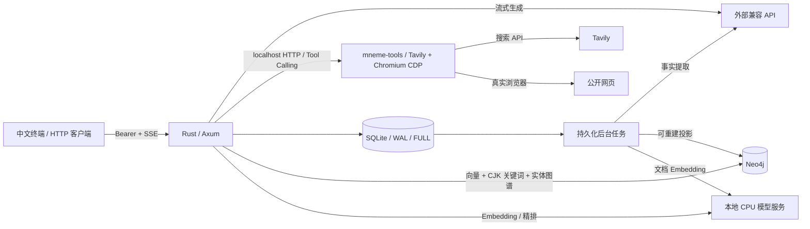

# mneme

以中文交流为主的单用户 AI 陪伴 Agent。Rust 核心提供多轮对话、SSE 流式回复、可配置人格、持续对话和长期记忆。外部兼容 OpenAI Chat Completions 的服务负责生成与记忆提取；Embedding 和 Reranker 完全在本地 CPU 上运行。

第一版已经实现完整链路，不需要 Redis、消息中间件、APOC、GPU 或额外向量数据库。生产使用前须填写自己的外部 LLM 配置。当前实现面向一个可信用户；不要把同一个 Token 分发给多个互不信任的人。

## 架构



- SQLite 是事实源，保存原始消息、对话状态、记忆版本、证据原文和任务队列。完整回复与记忆任务在同一事务提交；进程中断不会丢失已提交任务。
- Neo4j 保存有效记忆及实体关系，提供 HNSW 向量索引、CJK 全文索引、实体直接匹配和两跳邻居扩展。候选经 RRF 融合、本地 Reranker 精排，再结合重要性和时间衰减。
- Neo4j 故障时，从最近 256 条有效 SQLite 记忆做有界向量/中文双字检索；模型故障时仍可用关键词。降级会在 API 中标记，不保证降级期间召回全部历史。
- QQ、WebUI、终端和 API 共用同一个持久对话、上下文与长期记忆，并串行生成。后台记忆使用单独工作协程。模型服务采用有界优先队列，查询与精排优先于待处理文档；一个进程加载两个模型，使用 3 个 CPU 推理线程。
- 本地模型使用 FP32、512 token 输入上限、小批量推理和 256 条有界 Embedding 缓存。模型权重、GTE 自定义代码均固定到 Git revision，只允许 safetensors。

`mneme-api` 编排对话和连续工具调用，`mneme-models` 保持本地模型推理职责，`mneme-tools` 执行浏览器操作。搜索通过真实网页输入与点击完成，不使用搜索 API；图片和截图交给现有外部多模态 LLM 理解。部署、限制与安全边界见 [docs/tools.md](docs/tools.md)。

模块和数据设计详见 [docs/architecture.md](docs/architecture.md)。

## Debian 13 部署

目标为 4C16G、无 GPU、Rootless Podman 5.4+、cgroup v2。建议至少留出 15 GB 磁盘用于镜像、构建缓存、模型及数据；对话和记忆随使用继续增长。Quadlet 的资源上限为 API 2 GB、模型 8 GB、Neo4j 3 GB、工具 1.5 GB；这是上限，不是启动时预留。

安装系统依赖（服务本身不需要 root）：

```bash
sudo apt update
sudo apt install podman uidmap passt fuse-overlayfs dbus-user-session python3 curl ca-certificates
sudo loginctl enable-linger "$USER"
podman info --format '{{.Host.Security.Rootless}}'
```

最后一个命令应输出 `true`。使用正常登录的普通用户执行下面的步骤；该用户需要有效的 `/etc/subuid`、`/etc/subgid` 分配和 `systemctl --user` 会话。

```bash
cp .env.example .env
# 编辑 .env，填写 LLM API Key、URL、QQ AppID、QQ AppSecret。
# 每行 KEY=VALUE，不加引号；不使用 QQ 时，QQ 两项同时留空。
bash scripts/start.sh
```

安装会自动生成独立 WebUI 密码、API Token、工具 Token 和 Neo4j 密码，写回权限为 0600 的 `.env` 并保存到 `~/.config/mneme/`；重复安装会保留密钥、人格和数据。LLM 模型名可选：未填时首次从提供商 `/models` 自动选择第一个排除已知 Embedding、Reranker 等专用类型的模型并缓存，重启不会重新选型；目录接口不受支持时须填写 `MNEME_LLM_MODEL`。建议明确指定常用聊天模型。

GitHub Actions 仅构建 `linux/amd64`（x86_64）容器，发布 `ghcr.io/vesperglow/mneme-api`、`ghcr.io/vesperglow/mneme-models` 和 `ghcr.io/vesperglow/mneme-tools`。默认使用 `latest`；固定部署版本时，先 `export MNEME_IMAGE_TAG=sha-完整提交SHA`，再执行同样的拉取和安装命令。私有 GHCR 包需要先用具有 `read:packages` 权限的 GitHub Token 执行 `podman login ghcr.io -u VesperGlow`；也可以在 GitHub 包设置中改为公开。首次发布的包默认私有，详见 [GHCR 说明](https://docs.github.com/en/packages/working-with-a-github-packages-registry/working-with-the-container-registry)。从源码构建时，用 `bash scripts/build.sh` 代替拉取步骤，仍仅构建 amd64。

模型镜像已内置两个模型的权重、分词器、配置和 GTE 自定义代码，模型文件约 1.8 GB。首次拉取镜像较大，启动和重启无需访问 Hugging Face 或魔搭。模型固定版本并校验 SHA-256，验证后在 CPU 上加载；`podman logs -f mneme-models` 会显示校验和加载阶段。

内置模型位于只读的 `/opt/mneme-models/hub`，不会被已有 `/models` 持久卷遮挡，也不需要向旧卷复制权重；默认 `HF_HUB_OFFLINE=1`，临时代码缓存写入 `/tmp`。现有 Quadlet 和 `.env` 可直接沿用。安装脚本保留已有 `~/.config/mneme/config.toml`。

模型下载在镜像构建端完成：先 Hugging Face，失败后自动切换魔搭，使用分段请求和有限次数的断流续传重试。自建镜像可通过 `--build-arg MNEME_MODEL_SOURCES=modelscope,huggingface` 调整构建下载源。固定版本及校验清单见 `services/models/artifacts.json`，不要直接替换模型文件或 revision。

所有容器属于 `mneme` Pod，共用网络命名空间：内部地址为 Neo4j `127.0.0.1:7474`、模型 `127.0.0.1:8090` 和工具 `127.0.0.1:8091`。新增工具直接加入现有 `mneme.pod`，不增加 Pod 或宿主机端口。浏览器沙箱与出站代理阻止网页访问内部地址，但共享网络命名空间无法提供容器间的网络隔离，详见 [安全边界](docs/tools.md#共享-pod-的边界与防护)。宿主机只发布本机 `127.0.0.1:8080`（API/Console）和 `127.0.0.1:8081`（仅 QQ 回调）；QQ 未配置时不启动第二个监听。需要远程使用 Console 时可通过 SSH 转发：`ssh -L 8080:127.0.0.1:8080 user@server`。

```bash
systemctl --user status mneme.target
journalctl --user -u mneme-api -u mneme-models -u mneme-neo4j -f
systemctl --user restart mneme.target
systemctl --user stop mneme.target
systemctl --user start mneme.target
```

由 `mneme.target` 统一启动、停止和重启。Quadlet 生成的 service 无需单独 enable。容器故障由各自的 `Restart=on-failure` 恢复。

## 开始对话

新安装的 `.env.example` 启用工具；升级时，旧 `.env` 没有 `MNEME_TOOLS_ENABLED` 则保留原有聊天行为。使用支持流式 Tool Calling 的模型后，设置 `MNEME_TOOLS_ENABLED=true`，重新安装并重启。图片理解还要求该模型支持 `image_url`，不需要新增视觉推理服务。

网页搜索使用 Tavily：在 `.env` 填入 `MNEME_TAVILY_API_KEY=tvly-your-key`；多个 key 用 `/` 分隔，例如 `MNEME_TAVILY_API_KEY=tvly-key1/tvly-key2`，搜索请求会依次轮转使用。运行 `bash scripts/install.sh` 并重启 `mneme.target` 后生效。Chromium 继续负责打开网址、读取、点击和截图；未填 Tavily key 时仍可直接浏览网址。详见 [工具配置](docs/tools.md)。

QQ 接入遵循官方 BotGo 的 Webhook 协议，由同一 Rust 进程处理验签、Token 刷新和消息投递，不增加 Go 服务或容器。QQ 平台还须配置 **HTTPS 回调 `/qqbot`、`C2C_MESSAGE_CREATE` 事件和出口 IP 白名单**。配置完成后直接私聊即可，第一条消息会自动建立个人会话并生成回复，无需打开 Console 或发送绑定码。之后继续使用同一账号的对话与长期记忆；完整设置和测试边界见 [docs/qq.md](docs/qq.md)。

```bash
export MNEME_API_TOKEN="$(cat ~/.config/mneme/console-token)"
curl -sS -H "Authorization: Bearer $MNEME_API_TOKEN" http://127.0.0.1:8080/health/ready
python3 scripts/chat.py
# 再次启动会自动继续同一段对话，无需指定会话。
```

先说“我现在住在成都，我喜欢不加糖的拿铁”，之后可继续询问住址或偏好；关闭终端、刷新页面、重启服务都会延续同一段对话。提取是异步的，不保证在回复结束瞬间已经可召回。`/health/ready` 返回队列的 `pending/running/dead` 数量；首次没有记忆时，检索索引会在第一条投影任务执行时创建。

可在 Console 的 **Agent 页** 中修改名字、性格描述、交流方式、边界和输出格式 Prompt，保存后下一轮对话立即生效，重启后保留。输出格式可填写回复结构、Markdown 等要求，留空表示不额外约束。初始人格来自 `~/.config/mneme/config.toml` 的 `[persona]`；WebUI 保存的设置优先于文件，可用“填入配置文件默认值”后保存来恢复。已保存的角色背景随请求加入，不自动扩写、反思或重写；不依赖可能被裁剪的历史消息。旧版六维画像与行为进化记录只作为归档保留。临时连续信息复用原始历史和既有摘要，不生成独立心理状态；完整审计、Token数据和原始对话见[极简人格驱动改造](docs/reports/minimal-persona-2026-10-21.md)。

Agent 页还可批量上传自己的 PNG、JPEG、WebP、GIF 表情包，上传后由当前多模态聊天模型自动理解画面、文案、动作与适用场景，无需手动打标签；支持搜索、启停和可选修正。表情库全局共享，网页、QQ 和 API 回复均可按语境选用，重启和重置对话后保留。QQ 同时支持接收图文 / 纯图片并交给现有多模态模型理解，也能回复表情包、已有图片和工具截图。上传与 QQ 看图需运行工具服务；配置与限制见 [Console 表情包说明](docs/console.md#自定义表情包) 和 [QQ 图片说明](docs/qq.md#图片与自定义表情包)。

## Mneme Console

打开 **http://127.0.0.1:8080/console/**，使用独立密码登录内置管理后台。安装生成的初始密码保存在 `~/.config/mneme/console-password`，也可通过 `MNEME_CONSOLE_PASSWORD` 初始化；已有 WebUI 密码保持不变。支持流式聊天、图片上传、浏览器工具状态与调用记录、带统计与搜索的记忆库、记忆增删改查、来源与历史版本、混合检索调试、系统状态及独立 **Agent 页**；适配桌面与移动端。Agent 页管理性格、QQ 接入、上下文与重置；设置页修改 WebUI 密码。聊天为默认入口，导航和账号操作位于左侧，手机通过菜单展开。页面和资源由 Axum 直接提供，不增加容器或运行依赖。登录使用 HttpOnly、SameSite=Strict 的持久 Cookie，服务端仅保存会话凭证哈希；默认有效期 30 天，使用时续期，刷新、关闭浏览器或服务重启后仍可继续。主动退出、密码变更或过期后需要重新登录。`[console].session_days` 可设为 1–365 天，HTTPS 部署设置 `secure_cookie=true`。对话页显示 QQ 和网页的最近 200 条消息及来源，自动更新记录并保留输入草稿。使用及升级说明见 [docs/console.md](docs/console.md)。

## HTTP API

除 `/health/live`、Console 静态登录页面/资源和密码登录接口 `/v1/console/login` 外，所有 API 均要求 API Token 的 Bearer 认证或密码登录 Cookie，响应禁止缓存。WebUI 只提供密码登录，登录接口不向 JavaScript 返回凭证。JSON 请求最大 32 KiB，图片二进制上传最大 8 MiB，单次消息最多 4000 字符。不开放浏览器跨域访问或多租户功能。

| 方法 | 路径 | 用途 |
|---|---|---|
| GET | `/health/live` | 进程存活 |
| GET | `/health/ready` | SQLite、模型、Neo4j 连通情况与任务统计；依赖不可用返回 503，聊天仍可降级 |
| GET | `/v1/conversation` | 持续对话、当前生成轮次、上下文上限和滚动摘要 |
| GET | `/v1/messages` | 最近 100 轮完整对话 |
| POST | `/v1/chat` | `{"request_id":"UUID","message":"中文消息"}`，返回 SSE |
| GET | `/v1/turns/{request_id}` | 查询本轮状态与持久化消息 |
| GET | `/v1/memories?limit=50&offset=0` | 支持搜索、分类/状态筛选、排序及总数；默认不含已删除记录，不返回向量 |
| POST / PUT | `/v1/memories` / `/v1/memories/{id}` | 手动新增 / 带版本检查的编辑，自动排队更新索引 |
| GET | `/v1/memories/{id}` | 记忆、来源消息、会话、原文证据与修订历史 |
| POST | `/v1/memories/search` | `{"query":"我的咖啡偏好"}`，返回召回内容、得分与检索通道 |
| DELETE | `/v1/memories/{id}` | 逻辑删除，立即停止检索并屏蔽旧任务；后台清理图谱 |
| POST | `/v1/admin/jobs/retry` | 重置死信任务的尝试次数并重试 |
| POST | `/v1/admin/reindex` | 从 SQLite 排队重建所有记忆的 Neo4j 投影 |
| GET | `/v1/console/settings` | 当前性格、文件默认值、WebUI 密码设置状态 |
| PUT | `/v1/console/persona` | 保存性格，下一轮对话生效 |
| PUT | `/v1/console/password` | 设置或修改 WebUI 密码，使已有登录会话失效；不支持移除密码 |
| POST | `/v1/admin/reset` | 要求 confirmation=RESET，清空对话、记忆、任务及 QQ 会话；可同时恢复默认性格 |

旧 `/v1/sessions` 接口保留兼容：创建请求始终返回同一对话 ID，旧 API 和 QQ 会话及图片、工具记录启动时合并，旧 ID 继续指向全局对话。图片上传可直接使用 `POST /v1/images`。

SSE 事件包含 `meta`、可选的 `compaction`、每次模型请求的 `context`（本地估算）、`reasoning`（仅供应商返回的思考文本）、`usage`（API 用量快照）、多次 `delta` 与最终 `done`；失败时发送 `error`。`reasoning`、`usage` 以 `request_id` 区分同一轮中的多次工具模型请求；usage 是替换快照，不能按流事件累加。`meta` 包含 `memory_ids` 和 `retrieval_degraded`。`done.persisted=true` 表示完整回复与记忆任务已经提交，之前的 delta 都是暂时输出。工具调用或收尾重试时，`reply_reset` 要求清空本轮临时正文；可选的 `tool_progress` 仅为过程信息，不拼接进最终答复或历史。WebUI 支持撤回，终端客户端等待提交后打印最终正文。客户端断开后服务继续完成本轮；可通过 GET turn 查询结果。同一 `request_id` 和相同消息重试会重放已完成回复，不重复生成或提取。未完成/失败的旧 ID 返回 409，需查询状态，重试生成使用新 UUID。

## 长期记忆行为

QQ、API 和 WebUI 共用一个持续对话。`[llm].context_tokens=100000` 控制上下文预算，`summary_tokens=2000` 控制摘要上限；系统提示、历史、记忆、工具定义、工具参数、结果、实际回传的推理文本和回复预留都纳入 Token 预算。仅按预算触发压缩，不按 `history_turns` 截断；原始消息和来源保留。

优先采用 API usage，输入缓存和推理是输入/输出的子项，不重复加入总量。缺失字段保留 `null`，单独保存 `estimated`；累计同时返回实测总量、`reported` 覆盖次数、使用实测优先补缺的 `effective` 总量及 `estimated` 次数。未知的隐藏推理不能补造，没有输出 usage 时的已观测输出可能只是下限。流式 usage 是同一请求的替换快照；重放、模型客户端缓存命中及合并的并发请求不新增消耗。

`model_requests` 统一记录对话与工具循环、历史压缩、记忆提取、表情理解、Embedding 和 Reranker。CPU 服务返回对应固定模型 Tokenizer 在截断后实际处理的非填充 Token 数；查询指令、每个精排对中的查询、缓存命中都计入相应分项。批量提取跨多个来源时，请求归属于该批最后一个来源轮次，会话总账只计一次。

WebUI 区分下一轮上下文估算、每个对话模型请求、本轮累计和会话累计；按调用用途拆分。累计在后端统一计算，通过 `turn_usage` SSE 和历史接口返回。临时工具结果与推理不自动进入下一轮。上下文是保留内容的估算，并非本轮或会话的累计消耗。

文本估算按模型选择内置 tiktoken 词表；其他模型建议设置 `[llm].tokenizer_path` 或 `MNEME_LLM_TOKENIZER_PATH` 指向对应的本地 Hugging Face `tokenizer.json`。未知词表回退 `o200k_base` 时明确标记 fallback，`tokenizer_model_matched=false`；即使用对应词表，消息封装与图片开销仍是估算，不冒充 API 实测。官方 DeepSeek 离线分词器可从其 [Token 文档](https://api-docs.deepseek.com/quick_start/token_usage/) 获取，测试下载仅放在 `artifacts/`，生产不会自动下载。

继续使用现有 `/chat/completions` 兼容接口，支持 OpenAI/DeepSeek/Qwen 等兼容 usage、兼容网关透传的 Anthropic 缓存计数和 Gemini `usageMetadata`。未引入原生协议或 SDK。请求启用 `stream_options.include_usage`；仅在服务明确拒绝该选项时回退，不重试已接受的生成。计数语义参见 [OpenAI 流式 usage](https://developers.openai.com/api/reference/resources/chat/subresources/completions/streaming-events)、[Anthropic 缓存输入](https://platform.claude.com/docs/en/build-with-claude/prompt-caching#tracking-cache-performance) 与 [Gemini UsageMetadata](https://ai.google.dev/api/generate-content#UsageMetadata)。

记忆提取独立于压缩：`[memory].extract_every_tokens=2048` 累计完整用户/助手原文 Token；短对话在等待满 `extract_max_delay_seconds=120` 秒后的后台调度中排队，不要求继续发送消息。后台繁忙或依赖故障时，完成时间还包括排队和重试。水位和任务持久化，重启后重新计算未排队原文，压缩不推进提取游标。安装脚本写入 `MNEME_MEMORY_EXTRACT_TOKENS=2048` 与 `MNEME_MEMORY_EXTRACT_MAX_DELAY_SECONDS=120`，移除旧字符环境配置。旧 TOML 的 `summary_chars`、记忆 `context_chars`、`extract_every_chars` 接受为新 Token 字段的数值别名；建议明确改成新名称。旧会话水位保留，不重复提取已确认的来源。

1. 批次只从原始用户消息取证，逐字引用、置信度、重要性、敏感分类和语义证据校验仍生效。每组最多四个来源，模型须报告已处理的来源 ID；部分失败先保存有效事实，未完整来源保持有界重试，不伪造完成回执。
2. 使用向量索引与近期 SQLite 事实共同寻找相关旧属性；`attribute_of` 可声明同一主体/属性并沿用旧键，`equivalent_to` 只有同时匹配规范内容才确认。完全重复内容归并后记住键别名，后续通过任一键更新仍替换同一属性。重复确认合并实体并保留有效期限；同一来源的重试不会重复增加版本。
3. 原始消息序号决定新旧，批次按数据库顺序处理；晚到任务不能覆盖新事实。人工编辑/删除屏障、来源屏蔽、版本比较及投影重读保留，索引不是事实源。召回在精排后及压缩后再次核查版本。
4. 混合召回为原问题和最多三个保留原上下文的子问题取候选；RRF 融合向量、CJK 全文、SQLite 补检和两层共享实体扩展。全部候选交精排；低于 cosine 门槛的改写须通过更强的精排补救门槛。相对门槛逐分面计算，关系链附带仍有效的桥接事实；总时限、条数和 Token 预算保持有界。失效、删除和无关弱候选不注入。
5. 事实有效期使用带时区绝对时间，过期即时排除，每小时做衰减维护。重复明确告知刷新观察时间；被检索不会延长寿命。自然回复优先当前纠正，区分人物和时序，逐项回答复合问题，缺失部分单独说明。

这是可审计的记忆系统，不保证 LLM 的提取、等价判断或相对时间解析永远正确。重要事实可通过来源 API 核查。敏感分类依赖模型判断；不要把自动分类当作凭证保险箱。自然语言“忘记某事”目前不触发删除，使用 DELETE API 确定执行。

逻辑遗忘会保留 SQLite 原始对话和审计记录，删除后的内容仍可能存在于同一会话最近历史或备份中；需要彻底清空当前对话与摘要时，可在设置中重置 Agent；该操作也会清空长期记忆。此 API 不代表物理擦除，也不实现选择性原始数据销毁。外部 LLM 会接收当前消息、所需历史、滚动摘要、召回记忆；提取时还会接收批次内的用户原文及最多 24 条相关旧记忆。请按提供商的数据政策选择服务。

## 持久化、备份与恢复

| 位置 | 内容 |
|---|---|
| Podman volume `mneme-data` | SQLite、WAL、锁文件，唯一事实源 |
| Podman volume `mneme-neo4j-data` | 图谱、索引、Neo4j 认证数据库 |
| 模型镜像 `/opt/mneme-models/hub` | 固定版本的模型、分词器与 GTE 代码 |
| Podman volume `mneme-model-cache` | 历史下载缓存与断点，兼容保留 |
| `~/.config/mneme/` | 人格/检索配置及权限为 0600 的服务密钥 |

正常停止、重启、重建容器和更新镜像不会删除命名卷。不要运行 `podman volume prune` 清理仍需要的数据。SQLite 使用 WAL + `synchronous=FULL`、外键、数据库事务和单实例文件锁；原始消息保存为 UTF-8。数据库与备份不做应用层加密，部署时可使用加密磁盘，备份存到受控位置。

在线一致性备份（不要直接只复制 `.sqlite3` 而遗漏 WAL）：

```bash
mkdir -p backups
chmod 700 backups
mneme_volume_path=$(podman volume inspect mneme-data --format '{{.Mountpoint}}')
podman unshare python3 scripts/backup.py \
  "$mneme_volume_path/mneme.sqlite3" "backups/mneme-$(date -u +%Y%m%dT%H%M%SZ).sqlite3"
```

SQLite 备份已经包含所有重建记忆和图谱所需的信息。配置/密钥另行安全备份，模型可重新下载。恢复步骤及图谱丢失后的重建见 [docs/operations.md](docs/operations.md)。

## 开发与验证

GitHub 的 [build 工作流](https://github.com/VesperGlow/mneme/actions/workflows/check.yml) 在推送、Pull Request 或手动触发时执行格式检查、Clippy 和测试，再按镜像输入变化构建对应的 `linux/amd64` 镜像：Rust / WebUI / 迁移改动只构建 API，工具服务改动构建 tools，模型服务 / 权重清单 / 依赖改动才构建 models。比较基准是上一次成功发布，避免遗漏失败或取消的发布；手动触发会完整构建。未变的镜像复用现有内容，只补当前提交的 `sha-完整提交SHA` 标签，保留统一版本部署，不重新导出或上传模型层。Rust Release 二进制和内嵌 Console 均封装在 API 镜像内。只有 `main` 分支的推送或手动构建会发布 GHCR，标签为 `latest` 和 `sha-完整提交SHA`；Pull Request 仅验证构建。

每次构建只为实际重新构建的服务提供对应的 `mneme-linux-amd64`、`mneme-models-linux-amd64` 或 `mneme-tools-linux-amd64` 镜像归档及 SHA-256 文件，Artifacts 保留 7 天。下载解压 GitHub Artifact ZIP 后，可离线导入（将 `完整提交SHA` 替换为该次运行的 SHA）：

```bash
sha256sum -c mneme-linux-amd64.tar.gz.sha256
sha256sum -c mneme-models-linux-amd64.tar.gz.sha256
sha256sum -c mneme-tools-linux-amd64.tar.gz.sha256
podman load -i mneme-linux-amd64.tar.gz
podman load -i mneme-models-linux-amd64.tar.gz
podman load -i mneme-tools-linux-amd64.tar.gz
export MNEME_IMAGE_TAG=sha-完整提交SHA
bash scripts/install.sh
```

归档内使用同一 SHA 标签，无需 GHCR 登录，模型归档已包含全部模型文件。拉取 Neo4j 和访问外部 LLM 仍需要网络。日常更新可直接运行 `bash scripts/update.sh api tools`，只拉取并重启指定服务，模型容器和其版本保持不变；只改 Agent / WebUI 时用 `bash scripts/update.sh api`。不带参数表示更新全部服务；首次安装或变更 Pod / 公共单元仍使用 `scripts/start.sh`。`pull.sh`、`build.sh`、`install.sh` 也接受 `api`、`tools`、`models` 参数。脚本保留配置和持久卷。复用的未变镜像没有本次新归档；离线部署时保留之前已导入的镜像，或从此前的成功构建获取对应归档。

```bash
cargo fmt --all -- --check
cargo clippy --locked --all-targets -- -D warnings
cargo test --locked
python3 -m py_compile services/models/*.py scripts/*.py
python3 -m unittest discover -s tests -p 'test_*.py'
# Node.js 22+，浏览器容器与多轮真实联网测试见 docs/tools.md
npm ci --prefix services/tools
node --test services/tools/test/security.test.mjs
# 构建模型镜像后，用真实 CPU 模型与临时 Neo4j 运行集成测试：
bash scripts/smoke-services.sh
# 完整 Pod 生命周期测试：验证内置模型离线加载、整个 Pod 重启和在线备份。
python3 scripts/smoke-pod.py
```

常规测试使用本地确定性 HTTP 替身，不依赖外部付费 API；覆盖跨会话、重启积压、来源、去重、更新、遗忘屏障、时间衰减、死信重试、会话互斥、单实例锁、鉴权和分片/截断 SSE。真实服务测试验证固定模型加载、中文精排、CJK 全文、1024 维向量和图谱邻居，再走 Rust 混合检索。`smoke-services.sh` 保留模型缓存及独立测试图谱卷，清理测试容器。`smoke-pod.py` 使用真实 Rust 镜像、CPU 模型、Neo4j 与确定性 LLM 替身；它会检查整个 Pod 重启后的原始历史、跨会话记忆和在线备份，最终删除专用测试数据卷，保留模型缓存。

本机原生运行时先提供模型和 Neo4j 地址，导出 `.env.example` 中的三个必需密钥，再执行 `cargo run --locked`。默认加载 `config/default.toml`，可用 `MNEME_CONFIG` 指向其他文件。所有配置字段和环境覆盖在该示例及 [src/config.rs](src/config.rs) 中明确列出。

第一版预留了后台任务入口和 `relationship/emotion/event` 记忆类型；自我反思、关系状态演化、动态人格、主动消息需要后续独立实现，当前不会自行修改人格或主动联系用户。

实现参考：[Qwen3 Embedding 模型卡](https://huggingface.co/Qwen/Qwen3-Embedding-0.6B)、[GTE Reranker 模型卡](https://huggingface.co/Alibaba-NLP/gte-multilingual-reranker-base)、[Neo4j 索引语法](https://neo4j.com/docs/cypher-manual/current/indexes/syntax/)、[Podman 5.4 Quadlet](https://docs.podman.io/en/v5.4.2/markdown/podman-systemd.unit.5.html)。

本次实际执行的检查与测试边界见 [docs/validation.md](docs/validation.md)。

2026-10-19 的统一 Token 与记忆优化验证见 [测试报告](docs/reports/memory-tokens-2026-10-19.md)。
