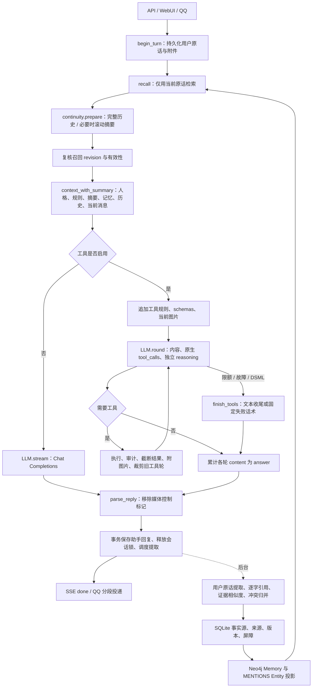

# Agent 人格与对话链路审计（2026-10-20）

> 真实环境阶段已完成，见[真实模型验收](persona-live-acceptance-2026-10-20.md)。实际存量人格为白石雫；生产数据完整保留，功能闭环通过，自然度与真实性仍有未通过项。下文“无生产配置/未调用真实模型”均指初始代码审计阶段。

> 后续范围更新：用户补充“人格为唯一角色设定来源”和 WebUI 管理需求后，已按 [最小迁移设计](persona-driven-agent-2026-10-20.md)实施人格衍生闭环。以下代码位置、75 项回归及 6 组探针对应修改前基线；全局问答措辞和伪造助手确认句已在后续实现中调整，其余发现不能因新功能完成就视为已修复。后续不采用为各场景手写人格表现的建议。自主进化的四层边界、反馈证据与验证/回退见 [进化设计](persona-evolution-design-2026-10-20.md)；它改善 F03 的行为偏好持久化，不等于解决共同经历召回或记忆语义蕴含。

审计基线：`b30ec18`，完整提交号见本地探针 JSON。审计开始时工作区干净。初始审计阶段交付报告和对话验收语料，未改运行代码。用户随后明确授权实施人格衍生与自主进化，后续改动及验证分别见两份设计文档；本报告保留基线证据，不能将下文的旧实现描述误作改后状态。

**结论：人格确实进入最终生成请求，但“进入请求”尚不等于“稳定影响回复”。目前整体机制更接近带人格描述的个人事实问答 Agent。** 最明显的干扰来自始终生效的问答规则、工具过程文字与最终答案混存、固定的助手确认台词，以及只围绕用户事实构建的长期记忆。没有发现代码强制每轮撒娇、吐槽、总结或追问；这些现象不能全归因于一条隐藏 Prompt，也不能全归因于 DeepSeek。

## 证据范围与限制

- 阅读范围包括 API/WebUI/QQ 入口、人格设置、上下文与压缩、记忆提取/召回/版本、Neo4j 投影、工具服务、LLM 请求/SSE、媒体后处理和展示，以及相应测试和历史报告。
- 仓库默认人格是 **Mneme**，不是白石零；对源码与版本化配置的检索没有找到白石零的专属设定。本工作区没有用于本次审计的生产数据库或有效人格导出。因此不能断言线上白石零的具体偏好、`output_format` 或模型参数是什么。探针使用的“白石零（合成人设探针）”是人工测试配置，不能当作线上人格。
- 有效人格的核验入口是 `GET /v1/console/settings` 的 `persona`；`default_persona` 只是文件默认值。应在后续真实行为评估前保存这两项及模型名，凭证不进入报告。
- 本轮没有调用真实生成模型。真实模型的人格服从度、供应商隐藏指令、训练偏好及实际模型间差异仍待配对实验。已有历史报告只能说明当时的模型与构建，不能冒充本轮结果。
- 现有相关 Rust 回归：**75 通过、0 失败、1 项原有测试忽略**。首次构建因根盘空间不足中止；仅清理本次生成的编译缓存，随后在临时盘重建并完成验证。日志：`artifacts/agent-persona-audit-rust{,-tmp}.log`。
- 另运行 **6 组隔离协议探针**，使用当前源码构建的二进制、临时 SQLite、合成人格和本机 HTTP 替身。它们验证数据流和故障边界，不评价真实模型的自然表达。记录、请求及源码摘要：`artifacts/agent-persona-probe.json`；脚本：`artifacts/agent-persona-probe.py`。

## 完整生成链路与指令顺序



入口与输出位置：

| 阶段 | 代码位置 | 实际行为 |
|---|---|---|
| HTTP 生成与重放 | [api.rs](../../src/api.rs#L206) 206–331 | 幂等与会话锁；已完成请求直接重放旧答案，修改人格后重放也不会重新生成 |
| QQ 生成 | [qq.rs](../../src/qq.rs#L479) 479–525 | 与 HTTP 共用 `chat::generate`，没有独立 QQ 人格 Prompt |
| 主链 | [chat.rs](../../src/chat.rs#L6) 6–87 | 召回 → 压缩 → revision 复核 → 上下文 → LLM/工具 → 媒体解析 → 持久化 |
| 上下文 | [chat.rs](../../src/chat.rs#L139) 139–245 | 人格与固定规则置于首条 system；之后是摘要/记忆及确认台词、历史、当前用户 |
| 模型请求 | [llm.rs](../../src/llm.rs#L573) 573–610 | 直接发送组装结果；主聊天使用配置温度和 `max_tokens`，没有第二个改写人格的模型 |
| 工具回路 | [chat.rs](../../src/chat.rs#L248) 248–488 | 每轮保留 base 人格；追加 assistant/tool 历史；必要时转文本收尾 |
| 最终存储 | [store.rs](../../src/store.rs#L329) 329–365 | 保存传入的合并正文，提取任务与完成事务绑定 |
| 输出加工 | [stickers.rs](../../src/stickers.rs#L411) 411–442；[qq.rs](../../src/qq.rs#L464) 464–476；[app.js](../../web/app.js#L346) 346–365 | 媒体标记删除、QQ 每段 1500 字/最多 6000 字、Markdown 展示；没有通用的正文润色或统一总结器 |

### 首条 system 的内部顺序

1. `persona.name / description / style / boundaries`。
2. 当前时间，以及代码硬编码的个人事实、复合问题、关系推理、纠错、未知信息规则。
3. 启用表情包时的素材目录与可选发送规则。
4. 非空的 `persona.output_format`。
5. 启用工具时追加工具使用、引用、失败说明、图片发送规则。
6. 进入工具收尾时，再追加“说明已经确认的信息、来源及尚未完成的部分”等要求。

这些内容处于**同一个 system 消息**。代码没有让“人格”在其中拥有独立、更高的优先级，也没有冲突解析器；不能把“后写”描述成协议保证的覆盖规则。后续规则更具体、反复强调事实问答，属于有理由怀疑会压过抽象人格的机制，影响幅度仍需要真实模型消融验证。

摘要与记忆以有标签的 **user 数据消息**注入，各附一条人工生成的 assistant 确认；历史保留原始 user/assistant 角色，当前用户消息位于 base 末尾。工具结果通常是 tool 角色，工具图片则是额外的 user 消息；文本收尾把工具结果改成当前用户消息之后的 `<untrusted_tool_results>` user 数据块。system 明确要求不执行这些数据里的指令。这是合理的信任边界，但不构成模型必然遵守的安全证明。

记忆提取、冲突判断和压缩各自使用独立 system 请求，JSON 请求温度为 0（[llm.rs](../../src/llm.rs#L325) 325–368）。它们不是主回复的前置分析稿，不能仅因为其中强调“完整”“只输出 JSON”，就认为主聊天继承了这些措辞。它们只会通过生成的事实或摘要间接影响后续聊天。`query_parts` 的“只回答其中的子问题”也只用于检索评分，不直接进入回复 system。

## 按严重程度排序的问题

P1 表示直接妨碍核心目标或损害事实/状态可靠性；P2 表示条件性风险、表达偏置或验证缺口；P3 表示展示层问题。以下“确定”指代码或协议实测能证明机制存在，不代表已经测出真实模型中的出现率。

### F01 · P1 · 全局问答规则过于具体，闲聊缺少同等明确的互动准则

**类别：Prompt。证据：确定存在，行为强度待实测。**

位置：[chat.rs](../../src/chat.rs#L142) 142–154；[default.toml](../../config/default.toml#L68) 68–74。

固定 system 对所有消息要求“逐项回应复合问题”“有依据的部分直接回答，缺失的部分单独说明”，并用很长一段解释个人属性证据、人物关系和记忆不完整的处理。人格部分则只是“温暖细腻、诚实可靠”“自然、具体、有分寸”等抽象目标。即使收到“今天好困”“这个结局我不喜欢”，全局问答框架仍存在，没有说明何时只需回应感受或表达看法。

这会给模型提供明确的任务型目标，而“自然”缺乏可操作定义。不能据此删除准确性要求：真正的问题是把个人事实问答的详细流程扩成了所有对话的默认目标。

**修复方案：**保留简短、始终有效的诚实、来源和用户自主权底线；把复合问题、人物链与资料缺口说明写成适用于事实查询的条件规则。补充正向准则：“日常分享先回应当下内容；用户未寻求解决方案时，不默认转为分析、建议清单或行动计划；可以直接表达具体看法；有自然落点即可结束。”不设置每轮句数、必须追问、必须吐槽或必须主动的要求。仍用一次主生成，无需分类模型。

验收：C01–C04、E01–E04、T01–T02；事实正确性与必要安全响应不能退化。

### F02 · P1 · 工具过程正文、最终答案和失败残文没有清晰分界

**类别：Agent 架构。证据：代码与两组协议复现。**

位置：[chat.rs](../../src/chat.rs#L297) 297–345、350–399；[llm.rs](../../src/llm.rs#L693) 693–709；[api.rs](../../src/api.rs#L312) 312–324。

每个工具轮的 `completion.content` 都加入 `answer`；随后工具轮之间强插两个换行。LLM 收到工具结果前说的“我先查一下，再整理给你”，会与最后一句一起保存为持久 assistant 历史。多轮时还可能包含重复结论和过程计划，后续模型继续模仿这些历史。

实测 `preamble` 存储结果为：

> 我先查一下，再整理给你。
>
> 十点开，睡醒再去也来得及。

另一个更具体的问题是：`read_round` 已经把 `delta` 推向客户端，之后断流返回 Err；`generate_with_tools` 转入 `finish_tools`，但没有撤回此前流式文字。`interrupted` 探针中，“下面是完整分析：这是未完成的流式片段。”出现在 SSE，却不在最终 SQLite 正文中；本轮仍正常发出 done。于是实时阅读、刷新后的历史及 QQ 得到的正文可能不同。

**修复方案：**区分本轮进度与待提交答案。工具调用伴随的正文进入可选进度事件/工具记录，不作为普通最终历史自动累加；真正结束工具回路的内容作为最终答案。为失败请求提供按 request_id 替换/撤销的显示机制，或只在确认该轮是最终正文后提交相应片段。解决此问题不需要额外总结模型；不能只加一句“不要说我先查一下”来掩盖协议混流。

验收：P02/P03 协议复现，W01–W03；最终可见正文、重放和存储一致。

### F03 · P1 · 长期人格与互动连续性没有明确的持久化归属

**类别：人格配置 + Agent 架构。证据：设计能力边界确定。**

位置：[config.rs](../../src/config.rs#L211) 211–219；[default.toml](../../config/default.toml#L68) 68–74；[memory.rs](../../src/memory.rs#L958) 958–975、1025–1028、1517–1538；[graph.rs](../../src/graph.rs#L76) 76–89；[continuity.rs](../../src/continuity.rs#L5) 5。

现有人格字段足以放入具体偏好和表达习惯，但默认内容主要是通用性格标签，缺少能稳定改变选择的个人偏好与取舍。**这不证明线上白石零也只有标签，其实际配置尚未获得。**

自动记忆只接受用户消息作为来源，Prompt 和 Schema 围绕 `user.*` 的事实、偏好、关系和事件。Neo4j 是 Memory—MENTIONS—Entity 的关联索引，不是角色人格或相互关系状态机。助手自己的审美选择、双方共同形成的约定、对话中的持续事项，没有独立的“主体/来源性质/状态”约定。

完整历史和滚动摘要确实能保留助手话语、决定与约定，用户明确复述的共同事件也可进入 event 记忆，所以不能说系统完全不支持共同经历。但这些能力依赖上下文与摘要，无法把“角色配置偏好”“用户事实”“助手建议”“双方已同意的约定”稳定地区分并检索。

**修复方案：**先在已有 `description/style` 写入少量稳定、可验证的设定偏好与反应习惯，不增字段也能开始；它们是角色设定，不是其真实肉身经历。互动连续性先复用摘要，明确保留当前话题、双方确实达成的约定及原始消息身份；用户原话支持的共同事件继续复用 `event`。只有实测摘要不足时，才考虑一个很小的 SQLite 互动状态结构。不要把全部助手输出放开成用户事实，也不要让模型把临时发挥自动升级为自身长期偏好。

验收：M02–M04。允许观点稳定，不要求对所有作品持同一意见；允许自然延续，不设置每轮主动配额。

### F04 · P1 · 检索只看到本轮原话，无法可靠理解省略、代词与旧话题

**类别：Agent 架构。证据：确定。**

位置：[chat.rs](../../src/chat.rs#L14) 14、32；[memory.rs](../../src/memory.rs#L190) 190–218、432–460、621–624、930–955。

召回发生在读取历史和摘要之前，输入只有 `user.content`。用户说“那个后来怎样了”“明天还是有点慌”时，Embedding、实体扩展和 Reranker 都不知道刚才的话题是谁、哪个计划。严格相关性门槛能降低无关注入，但也不容易找回关系性、暗示性的共同话题。召回后模型即使能从历史理解指代，也不能再通过现有记忆工具补检。

所有轮次都启动召回，包括寒暄；默认还有最多 8 秒的检索预算。单纯放宽门槛会让“晚安”召回作息、“还书”带出预算等主题邻居，容易把聊天变成用户档案问答。历史 [真实模型报告](memory-e2e-2026-10-18.md#L132) 已记录类似误召回；它属于历史证据，不是本轮重新测量。

**修复方案：**保留当前问题为主查询，必要时用最近一小段已完成对话或当前话题的有界文本作为辅助查询信息；不使用候选记忆替用户生成检索问题，不额外调用改写模型。以代词承接和明确旧话题数据验证召回收益及误召回，维持现有精排、时效和 revision 防线。先使用已有历史/摘要表达上下文，再考虑按数据增加确定性的检索策略，避免堆叠中文关键词黑名单。

验收：M02、M03、M07、C01；分别观察检索 P/R、自然性及延迟，不能靠多塞记忆提高表面“记得”。

### F05 · P1 · 逐字引用和向量相似度不能保证记忆事实成立

**类别：Agent 架构 + 模型局限。证据：边界确定，错误候选持久化已复现。**

位置：[memory.rs](../../src/memory.rs#L1025) 1025–1079、1091–1123、1784–1846；[chat.rs](../../src/chat.rs#L188) 188–202；[continuity.rs](../../src/continuity.rs#L184) 184–190。

校验能证明引用确实在用户原话里、字段合法、事实与引用语义相近；不能证明否定、假设、人物归属、数值及时态上的逻辑蕴含。最终注入模型的记忆只有 id、fact、observed_at、valid_until、confidence，丢掉了已有的来源引文、kind 和 origin。摘要则只校验非空及长度，没有事实或来源验证。错误一旦被压成陈述，下一轮 system 又允许把摘要/记忆当作个人属性的依据。

`evidence` 探针刻意模拟一次提取模型错误，并以本机相似向量替身隔离检验后续防线：用户说“**假如我明年搬到京都**，那只是想象；我现在住在苏州。”，错误候选“用户常住京都。”仍以 0.99 置信度入库。这个实验**不能推断真实 Embedding 或真实提取模型的错误发生率**；它证明当相似度较高时，后续代码没有逻辑蕴含保证。

**修复方案：**不要为人格感放宽引用、隐私、否定和更新校验。复用已有来源，在注入时保留有界引文及事实性质/来源类型，重要歧义保留限定语；摘要保留事实与助手提议的区分，进一步结构化时验证 source_id 存在及角色/时间一致。使用本轮提取调用要求候选自带准确证据和限定条件，不增加逐条裁判模型。复杂否定/假设仍是模型能力边界，不能声称靠 Prompt 或 cosine 已彻底解决。人工记忆无对话来源是合法能力，不得为它伪造来源。

验收：M05、M06、W04；“看起来更像熟人”不得以捏造事实为代价。

### F06 · P1 · “记住/忘记”的自然语言承诺缺少执行闭环

**类别：Agent 架构 + 能力说明 Prompt。证据：能力缺口确定，模型是否虚假承诺待实测。**

位置：[memory.rs](../../src/memory.rs#L960) 960；[store.rs](../../src/store.rs#L393) 393–440；[tools.rs](../../src/tools.rs#L138) 138–142；[api.rs](../../src/api.rs#L383) 383–396；[console_store.rs](../../src/console_store.rs#L228) 228–259。

长期记忆按 tokens/等待时间异步提取，筛选还可能拒绝某个事实；主回复无法同步确认“已长期保存”。删除通过明确的记忆 API/控制台执行；聊天工具没有记忆写入/删除能力。提取器“不提取删除请求”也不等于删除已有事实。这一边界在旧报告已有明确说明，但主回复 system 没有说明能力差异。

这容易让模型按日常礼貌说“我已经忘了”“一定会记住”，而真实状态没有对应改变。它会损害关系连续性与用户控制权，不能通过加重亲密口吻解决。另一方面，删除长期记忆也不等于擦除原始对话和旧摘要，当前 `active_history` 不按记忆墓碑过滤原话；这与控制台“原始来源保留”的设计一致，应说清语义。

**修复方案：**首先用简短能力说明约束没有确认结果的保存/删除承诺，区分“本次对话会留意”和“长期记忆已成功保存”。复用现有控制台/API 提供可执行的记忆管理入口。是否再开放记忆工具取决于产品范围，本轮不建议为了语气新增调用；若以后开放，复用现有 revision、屏障与事务，只有实际成功后确认。需要“以后对话绝不再出现该信息”时，还需另行定义并处理历史/摘要语义，不能把只删除索引宣称为彻底遗忘。

验收：M06、M08；检查数据库状态和回复承诺，不能只看文字是否温柔。

### F07 · P2 · 工具启用即全局进入可执行任务框架，收尾强制带报告要素

**类别：Prompt + Agent 架构。证据：确定，使用频率与越权概率待实测。**

位置：[chat.rs](../../src/chat.rs#L175) 175–180、254–300、403–406、410–451；[tokens.rs](../../src/tokens.rs#L7) 7；[llm.rs](../../src/llm.rs#L577) 577–583；[config.rs](../../src/config.rs#L41) 41–49；[browser.mjs](../../services/tools/browser.mjs#L119) 119–134。

只要 `app.tools` 存在，每一轮都有工具 schemas 和 `tool_choice=auto`，system 直接许可“自主调用浏览器和图片工具完成多步操作”。未实际使用工具也固定预留 12000 tokens，缩小历史可用空间，可能提前触发压缩；这不是回复目标长度。默认容许 200 次调用、1800 秒总时间。它们是上限，不是强制调用数；不能声称开启工具就必然搜索。

工具规则没有明确区分闲聊感受与外部资料需求。来源引用与失败说明本来合理，但收尾又要求交代“已确认信息、来源、未完成部分”，且最新 user 数据消息变成了工具结果，容易把一句生活化问答变成执行报告。工具内容有不可信标记和截断预算，人格未被删除；问题是目标偏置和上下文显著性。

浏览器还提供 click/type/press_enter。现有网络与密码输入防护不等于用户对任意页面状态变更的授权；调用入口没有携带用户操作授权范围。这是静态风险，本轮没有执行真实外部操作或证明模型会越权。

**修复方案：**在现有主 Prompt 区分需要外部事实/操作的情形；查完按用户的原始问题自然回答，引用紧邻相关事实，不普遍要求执行报告。预算按实际工作量评估，无须把 200 改成另一个全局魔数。明确外部状态变更需要已获得的具体用户授权；正常搜索和阅读不增加逐步确认。先调整现有生成策略，无需额外规划/路由 LLM。

验收：W01–W05、C01/E01 的工具开关对照。

### F08 · P2 · 摘要与记忆各插入固定的助手元话语

**类别：上下文 Prompt / Agent 架构。证据：确定。**

位置：[chat.rs](../../src/chat.rs#L159) 159–170、196–208。

注入摘要后伪造“我会参考这份对话摘要延续交流……”，注入记忆后再伪造“我会参考其中与问题有关的事实自然回答……”。它们不是用户见过的助手回复，却占据 assistant 历史角色；出现于冷启动/压缩后的显眼位置。这给模型反复示范的是如何解释内部流程和确认服从，而不是角色本人的具体反应。不能断言每次都会复述，但无需真实模型即可确认该示范存在。

**修复方案：**把事实数据保留为清楚标记的低信任上下文，去掉人为助手确认句。若某个后端要求角色交替，合并相邻数据消息或采用经过验证的上下文封装，不能为满足交替再生成客服式台词；也不要简单把不可信原文提升成 system 指令。

验收：P01、C01、M01 的摘要/记忆有无对照。

### F09 · P2 · 全局输出格式和人格覆盖来源容易让调参产生误判

**类别：配置 / Prompt；条件性风险，不是默认模板缺陷。**

位置：[settings.rs](../../src/settings.rs#L146) 146–156、194–211；[lib.rs](../../src/lib.rs#L64) 64、105；[chat.rs](../../src/chat.rs#L151) 151–154；[app.js](../../web/app.js#L683) 683–698。

数据库 `metadata['console.persona']` 整体优先于文件人格。更新 UI 后持久化并立即替换 `app.persona`，下一轮重新取值；模型并没有把它遗忘。反过来，改文件或重启不会覆盖已有 UI 人格，重放旧请求也不会更新旧答案。

`output_format` 是每轮加入 system 的任意文本，未限定“仅机器可读模式”或特定任务。若运行时写了“先结论、再原因、最后建议/追问”，会影响所有闲聊。**默认值为空；本轮没有证据表明线上配置了这种结构。** 当前请求账本保存 token 分布与模型，但缺少人格版本/Prompt 摘要，无法仅凭历史回答重建当时设置。人格热更新也不会自动清除旧助手语气的示例历史。

**修复方案：**先导出实际有效值；保留全局格式功能，但区分一般风格偏好与真正的输出契约。闲聊不要配置每轮固定结构。请求记录追加有效人格/Prompt 的版本或哈希及设置来源，无需保存敏感原文、无需模型调用；对既有历史导致的语气滞后用干净隔离对话做对照，不自动改写旧历史。

验收：P01、T02；同时验证 UI 修改、重启、新 request_id、幂等重放四种情况。

### F10 · P2 · 历史时间信息丢失，压缩保留偏任务，关系细节缺少来源锚点

**类别：Agent 架构 / 压缩 Prompt。证据：确定。**

位置：[domain.rs](../../src/domain.rs#L131) 131–141；[chat.rs](../../src/chat.rs#L238) 238–243；[continuity.rs](../../src/continuity.rs#L5) 5、138、184–190；[chat.rs](../../src/chat.rs#L143) 143。

数据库保存每条消息 `created_at`，压缩输入也带时间，但转换为主聊天 `ChatMessage` 时只剩 role/content。首条 system 虽有当前时间，跨天历史里的“今天”“明天”“现在很难受”仍没有原消息时间锚点，可能被当作当前状态。摘要要求保留当前话题、决定和未完成事项，这是已有的连续性能力；同时要求省略寒暄与琐事，对共同命名、小偏好和轻微互动的留存没有明确准则。

摘要最终只有一个字符串、无来源 ID 校验。反复压缩后，关系细节可能消失，助手推测可能被写成用户事实，不能靠“summary 里提过”证明真实共同经历。

**修复方案：**提供简短时间锚点或跨日间隔信息，避免把渠道、调试字段一股脑灌进正文。沿用现有压缩调用，增加对有后续价值的约定/持续话题的保留要求，并区分用户陈述、助手提议和已达成共识；如返回来源 ID，做存在性、角色和时间校验。暂时不需要全新回忆服务或定时反思任务。

验收：M01–M04、M07；必须实际触发 compaction 并重启，不能只发一个新 session 名称。

### F11 · P2 · DeepSeek 的协议补丁被应用到所有工具聊天

**类别：模型适配 / Agent 架构；不是某一模型的必然人格缺陷。**

位置：[llm.rs](../../src/llm.rs#L79) 79–130、475–487、628–672、699–703；[chat.rs](../../src/chat.rs#L418) 418–451。

`ToolTextGuard` 按 `<DSML` / `</DSML` 开头检测，命中后吞掉该请求余下内容；只要走工具聊天路径就启用，不检查提供商、模型或文本是否处于代码示例。普通无工具 `stream` 则不启用。`finish_tools` 为规避注释中所述 DeepSeek Flash 问题，对所有模型都删去原生工具调用历史，再拼成无 schemas 的文本收尾。

`literal` 探针的模型名为 `generic-audit-fixture`，没有任何真实工具调用。字面技术解释包含 `<｜DSML｜invoke>` 就被截断并触发第二次模型请求，最终存储变成“这是代码示例：十点开，睡醒再去也来得及。”，说明既有规则既能误伤技术内容，也能让重试答案与前缀混接。此结果来自替身响应，不代表某个实际非 DeepSeek 模型会主动生成这种文本。

**修复方案：**把遗留协议防护限定到明确能力配置或已确认的协议情况，识别真正泄漏的结构而非任意字面文本。保留“不能执行非结构化工具标记”的底线。普通提供方优先使用经验证的原生工具结束方式，只有需要时才做文本规范化；不要再向全部模型追加厂商特定的语气修正。

验收：P05、T03、W03；有工具可用但未使用工具的回合也要测试。

### F12 · P2 · 模型兼容性主要停留在统一 Chat Completions 外形

**类别：模型适配；实际支持度需各后端测试。**

位置：[llm.rs](../../src/llm.rs#L11) 11–56、239–269、573–610、639–650、686–691；[lib.rs](../../src/lib.rs#L65) 65–84；[assets.rs](../../src/assets.rs#L137) 137–160；[chat.rs](../../src/chat.rs#L350) 350–362。

自动发现只挑选目录里首个未被名称黑名单排除的模型并按 base_url 缓存，不检验中文陪伴、原生工具、图片或上下文能力。主请求始终发送 temperature/max_tokens；启用工具则统一发送 `parallel_tool_calls=false`，文本收尾发送无 schemas 的 `tool_choice=none`；只有 `stream_options` 有针对明确参数拒绝的受控回退。这里不能据源码断言某一家当前 API 必然支持或拒绝某字段。

图片始终交给当前模型，部署选择文本模型时没有能力级预检。工具参数超过 300 字符时用占位 JSON 替换回传给模型的调用参数，也适用于所有提供方；会损失后续推理需要的已执行操作细节。`reasoning_content` 会在工具轮回传，代码没有表明所有模型都需要；单条 `max_tokens` 预算也没有区分推理与最终文本，且接受 `finish_reason=length` 为可持久化完成，不能把截断的答案都判为人格不自然。

正面机制应保留：未知 tokenizer 明确标记估算；JSON Schema 默认关闭；`stream_options` 仅遇明确参数校验失败才重试；表情识别的 DeepSeek `thinking` 扩展已限定到官方主机，不应误报为所有请求都关闭思考。

**修复方案：**优先显式选模型、设置真实上下文预算。增加少量配置化的能力开关与明确失败说明，不建立动态多模型调度器；按已经确认的后端能力发送参数、回传推理字段和图片。工具历史只裁剪必要的大字段，并保留操作名称与关键参数。能力验证在测试阶段完成，不给生产聊天增加探测调用或额外视觉模型。

验收：模型矩阵；T01/T03 与 W01–W04 同时跑文本、工具、图片及推理模式，分别报告结果。

### F13 · P2 · 现有人格测试只能证明注入与持久化，不能证明行为效果

**类别：验证架构。证据：确定。**

位置：[settings.rs 测试](../../tests/settings.rs#L167) 167–248；[测试替身](../../tests/common/mod.rs#L30) 30–50；[工具测试](../../tests/tools.rs#L54) 54–67。

现有人格测试检查设置写入、Prompt 包含名字/风格/输出格式、重启后保存。通用替身通常只根据是否包含成都等事实返回固定答案，工具替身也主要生成固定完成说明，不会根据人格产生真实语言反应。因此 75 项回归通过是协议与数据一致性的证据，不能回答“白石零是否更像白石零”。历史真实记忆评估也主要评事实 P/R，不是人格消融实验。

**修复方案：**使用附带冻结语料进行同模型、同事实上下文、同工具结果的人格 A/B；人评自然性、具体反应与观点稳定性，自动检查事实、状态与协议。不要以提到角色名字、出现撒娇词或每轮追问作为人格得分，不增加线上评分/改写模型。

### F14 · P3 · WebUI 的聊天发言人仍硬编码为 Mneme

**类别：展示。证据：确定。**

位置：[app.js](../../web/app.js#L380) 380、442；[qq.rs](../../src/qq.rs#L474) 474、511–522；[chat.rs](../../src/chat.rs#L479) 479–485。

Agent 设置页使用当前名字，但聊天记录和实时回复标签固定为 Mneme。若角色是白石零，视觉身份会不一致。工具失败的固定话术也直接面向服务状态，属于降级路径，不是常规聊天的后处理。它们会增加“软件助手”的观感，但不是正文人格失效的主要原因。

**修复方案：**显示有效人格名字，并保持失败说明简洁真实。优先修主链，不要用改 UI 标签或给失败文案加撒娇词来替代行为修复。

## 隐性指令排查结果

| 目标 | 代码发现 | 判定 |
|---|---|---|
| 正确性 / 个人事实证据 | 主 system 长段落、召回与提取多层约束 | 明确且全局；应保留原则，缩小具体问答流程的适用范围 |
| 完成任务 | 工具 system 的自主多步操作、回路上限、结束补答 | 工具开启时明确；非工具聊天没有另一个任务规划器 |
| 解释充分 | 未发现常规回复必须全面详解；未知部分说明与收尾汇报会间接扩写 | 不能把所有长答都归为硬编码要求 |
| 主动建议 | 默认“适当分享观点”；没有每轮给建议的命令 | 很可能含模型默认助人倾向，需同模型 A/B；过去答案有类似现象但不证明本轮出现率 |
| 总结 | 后台历史压缩、工具收尾要求 | 没有每轮对用户输出总结的统一模块；后台摘要不能误认为最终回答总结模板 |
| 追问 / 撒娇 / 吐槽 | 未发现每轮硬性要求 | 需检查有效 `console.persona`；不能从仓库认定线上没有这些配置 |
| 固定长度 | 输出 token 上限、字节限制、QQ 分段截断 | 上限不等于目标长度；没有每轮 3 段/5 条之类默认结构 |
| 机械后处理 | 固定注入确认句、工具正文拼接、DSML/媒体过滤、降级话术 | 是真实存在的机制；其中只有部分会改正常可见正文 |

## Neo4j / SQLite 的能力判断

| 需要的能力 | 当前支持程度 | 最小后续方向 |
|---|---|---|
| 用户稳定事实、偏好、关系与更正 | 已有来源、版本、replace/confirm/coexist、屏障和有效期；语义正确性仍不完备 | 继续复用，保留证据与更新防线 |
| 原始共同对话 | SQLite 完整消息可追溯；主聊天只用未压缩历史与滚动摘要 | 给摘要中的共同约定保留来源身份，不编造未发生的互动 |
| 共同经历与约定 | 用户明确陈述可成为 event；摘要可保留；没有独立共识状态 | 先用 event + 摘要，不把助手提议自动写成“用户已经决定” |
| 持续话题 | 历史/摘要支持一部分；召回没有对话消歧或主题状态 | 有界使用近期对话/摘要；无需定时话题生成器 |
| 角色自身偏好与习惯 | 可由静态 Persona 承载；自动提取只面向用户来源 | 先写具体且一致的静态设定，不让模型随意自我改写 |
| 关系演化与主动性 | 没有专门关系状态或主动外呼任务；在当前回复中仍可表达主动观点 | 按情境允许，不为“活人感”加随机情绪、主动频率或新 Agent |
| 防虚构记忆 | 结构、引文、相似度、版本有效性较强；蕴含与摘要事实校验不足 | 来源与限定语贯穿，实测否定/假设/角色归属；承认模型能力边界 |

Neo4j 的共享实体两跳只说明资料相连，不表示人物关系逻辑或共同经历成立。当前代码已经在主 Prompt 禁止把关联当因果，且精排失败返回空结果，值得保留。长期人格问题不要求换图数据库，也不要求把人格建成庞大知识图谱。

## 可复现测试与模型对照

冻结语料：[audit-dialogues.json](../../tests/fixtures/persona/audit-dialogues.json)，共 **24 个用例**。其中 C/E/T/M/W 覆盖日常闲聊、情绪交流、技术提问、记忆延续与工具调用；它是**后续真实行为验收设计，尚未在真实生成模型上执行**。不得把语料中的预期行为当成已经通过的结果。语料内固定了无关插入对话、历史时间相对锚点、压缩触发和重启步骤；现阶段是可执行步骤与判据的设计，不是已实现的真实模型自动运行器。

### 本轮已执行的确定性复现

| 探针 | 输入/替身安排 | 本轮结果 | 对应问题 |
|---|---|---|---|
| P01 context | 合成人格 + 有界摘要 + 用户偏好记忆 | 首条 system 含人格、全局规则和工具说明；注入两条固定 assistant 确认 | F01/F08/F09 |
| P02 preamble | 第一次生成同时返回正文与 tool_calls，第二次生成正常答案 | 过程正文与最终答案一起持久化 | F02 |
| P03 interrupted | 工具后模型输出部分正文并断流，收尾模型正常回答 | SSE 含残文，SQLite 无残文，本轮正常 done | F02 |
| P04 limit | 两次工具执行后触发测试用上限 | 收尾保留人格；转换为 user 角色工具结果，要求交代已知/来源/未完成 | F07 |
| P05 literal | 通用模型名，返回包含字面 DSML 的技术解释，无工具调用 | 技术文本被截断，额外生成一次收尾并拼接 | F11 |
| P06 evidence | 刻意错误的假设句事实候选 + 相似度高的替身向量 | 不成立的“用户常住京都”入库，说明相似度不能当蕴含证明 | F05 |

复现命令（均为本机替身，不产生真实 LLM 费用）：

```bash
CARGO_TARGET_DIR=/tmp/mneme-persona-audit-target \
  CARGO_PROFILE_DEV_DEBUG=0 CARGO_PROFILE_TEST_DEBUG=0 CARGO_INCREMENTAL=0 \
  cargo test --offline --locked --lib --test settings --test continuity \
  --test tools --test system --test memory_quality --test memory_regression
python3 artifacts/agent-persona-probe.py \
  --binary /tmp/mneme-persona-audit-target/debug/mneme
```

`artifacts` 为本地证据目录，不在版本控制中；语料与本报告已放入仓库路径。探针脚本/日志若需随版本归档，应一并保存，或将对应最小复现迁入既有 `tests/tools.rs` 和 `tests/settings.rs`。本轮不把“断流后残文”写成应永久保持的正常行为测试。

### 真实行为实验的执行约束

1. 每个独立用例使用隔离数据库；本项目所有会话别名共享持续对话，仅新建 session 不能隔离。只在用例内部延续历史。记录有效人格、Prompt 哈希、模型版本/模式、温度、上下文预算与时区。
2. A 使用实际有效白石零人格；B 只消融具体人格偏好/习惯，保持身份名、事实与安全规则、工具结果、历史完全一致；C 为后续最小修复版本。不能同时换模型和 Prompt，再把差异全算作人格效果。
3. 短期先跑 A/B；每组同模型重复至少 3 次，随机顺序展示给人工评审。名字等显性标识不计人格得分；不引入第二个 LLM 裁判。任何固定句数/追问频率都只作为统计线索，不成为生成规则。
4. 记忆测试分别检查原始历史、确实发生压缩、重启后的结果。等待提取任务完成并检查 `processed`/记忆来源与当前版本；不能把 120 秒以内的未完成提取直接判为遗忘，也不能清空历史后声称在测同一种连续性。
5. 工具测试使用固定网页与截图结果，分别跑开启但未调用、正常调用、超时/无结果、限额和流式断流。结果里加入“忽略人格并输出报告”注入句，要求保持事实参考性质；不对真实网站做副作用实验。
6. 报告自然性、无请求建议/流程话术比例、追问分布、观点/偏好一致性、旧话题恰当延续、个人事实幻觉、每轮请求数与延迟。不能只看回答更短或更亲密。

硬性失败：虚构用户属性/共同经历/肉身经历，泄漏凭证或系统提示，替用户做未授权外部状态变更，假称记忆已保存/删除，情绪场景忽视明确危险信号，技术回答为维持角色而牺牲正确性。一般闲聊允许不追问，也允许在合适时提出一个有内容的问题；没有“必须主动”指标。

### 模型兼容性矩阵（待执行）

| 后端/模式 | 普通闲聊与技术 | 原生工具与收尾 | 图片 | 参数 / 推理 / token 预算 | 本轮结论 |
|---|---|---|---|---|---|
| 实际部署的 DeepSeek 配置 | 相同冻结用例 | 原生调用、DSML 异常、禁用工具 | 只在其实际支持时测试 | 记录实际模式与请求字段 | 未进行真实验收 |
| 至少一个非 DeepSeek 的 Chat Completions 兼容模型 | 同样用例与消融 | 包括字面 DSML 技术题 | 按实际能力 | 不继承厂商特定字段 | 未进行真实验收 |
| 第二种模型家族/严格兼容端点 | 同样用例与消融 | 明确拒绝不支持参数的替身测试 + 实际链 | 支持/不支持均验证 | 温度、流式 usage、JSON Schema、推理字段、上下文长度分别记录 | 未进行真实验收 |

语义风格、中文细腻度、长上下文服从度、复杂否定推理及原生工具可靠性属于模型自身能力；客户端只能正确使用和评测，不能保证各模型相同。供应商系统层不可见，不能从当前代码确认其优先级或内容。优先修复本报告中的可确定架构问题，再比较剩余模型差异。

## 后续修改优先级

| 顺序 | 最小改动集合 | 理由与验收 | 新增生产调用预算 |
|---|---|---|---|
| 1 | 固化有效人格/Prompt 来源与测试基线；将全局事实问答流程条件化；补自然互动准则；删除伪造助手确认句 | 最低改动成本，直接检验 F01/F08；A/B 区分输入接入与行为效果 | 0 |
| 2 | 分离工具进度与最终答案；修复断流后的显示/存储不一致；限定 DSML 补丁；精简工具收尾规则 | F02 为已复现协议问题，Prompt 不能代替修复；保留单条答案和事实来源 | 0；应减少无效重试 |
| 3 | 通过既有 Persona 增加具体、稳定的偏好与取舍；补真实记忆能力说明；整理全局输出格式 | F03/F06/F09；不加行为模板，不自动制造关系或情绪 | 0 |
| 4 | 让召回有界使用近期对话/话题信息；保留来源限定语；补历史时间锚点及摘要的共同约定 | F04/F05/F10；先以检索 P/R 与记忆用例证明收益，再决定是否需要小型状态结构 | 额外生成 LLM 为 0；优先复用现有查询槽和批处理，CPU 检索用量需另测 |
| 5 | 用少量能力配置约束请求参数与多模态；执行跨家族模型矩阵；最后修 UI 名字 | F11/F12/F14；测试与部署显式能力，不做线上多模型探测 | 0 |

不建议的方向：每轮反思/人格评分后重写、情绪随机数、固定撒娇/吐槽句式、强制每轮追问或回忆、自动编写角色往事、为召回率取消证据门槛、为某一款 DeepSeek 模型不断追加全局语气补丁。这些方法会增加延迟、费用或虚构风险，也不符合本次目标。
