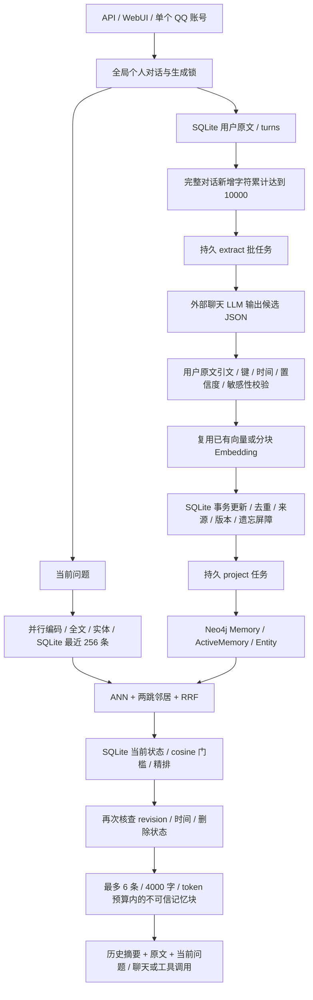

# Mneme 长期记忆审查、压力测试与修复报告

日期：2026-10-17。基线：`8747e72498d81c699709fea79daaf841ab33b915`。修改保留 Rust/Axum、SQLite、Neo4j、现有 HTTP 接口及本地模型。

本次完成代码审查、隔离基线、两类负载矩阵、真实离线模型评估、多轮修复和回归。没有读取真实用户 SQLite，没有启动生产服务，没有使用外部聊天模型 API、下载模型、迁移生产库或删除真实记忆。

**结论边界：真实提取 LLM 的语义准确率仍未测。** 当前提取复用外部聊天模型；本地两个模型负责 Embedding 和精排，没有另一个“小模型判定”服务。自然对话回放使用预设模型输出，验证输出之后的校验、存储和演化；不能将回放通过率当作远端模型的事实判定能力。真实语义评估使用已缓存、固定版本的 CPU 模型。

## 1. 架构与调用链



- SQLite 是事实源；Neo4j 只保存检索投影。记忆按 slot 和内容哈希唯一，旧值通过 superseded 链保留；原始来源和修订可追溯。
- 单消息提取最多 8 条，批量最多 32 条。提取任务确认与候选写入同一事务；`extracted_messages` 防止重试重复增强。观察先后以消息 seq 判断，不依赖秒级时间戳或任务到达顺序。
- 后台 worker 仍串行领取任务；失败指数退避，最多 8 次转 dead，启动恢复 running。定期衰减按原始观察时间计算，不把重建时间当作新证据。
- 所有 API、WebUI、QQ 会话合并为一个个人上下文。**session 不是用户边界；当前系统不支持同一实例内的多租户。** 多用户应部署独立 SQLite、Neo4j 与凭证。
- 原有删除接口使用墓碑、属性/内容屏障及来源抑制；修复后普通 forget/衰减路径也复用屏障。新发生的明确观察可以重新记忆；旧排队来源不能用已知旧内容换一个键绕过遗忘。

## 2. 测试设计与安全

硬件为 4 个逻辑 CPU、约 7.7 GiB 内存，另有交换区。Rust `1.98.0`，测试使用未优化的 test profile；这些数字用于同机回归，不能当作 release 部署 SLA。

Neo4j 使用独立容器和 tmpfs：CPU 上限 2、堆上限 512 MiB、page cache 64 MiB、容器内存上限 1536 MiB。模型使用 CPU FP32、2 个推理线程、3 GiB 容器内存上限，单工作线程与 16 项等待队列。只读挂载已校验的固定权重。模型为 Qwen3-Embedding-0.6B 与 gte-multilingual-reranker-base；具体 revision 保存于机器可读结果。

所有 SQLite 来自 `TempDir`。压测入口拒绝占用中的测试端口，只创建带随机运行标识的容器；Rust 压测还检查 Neo4j 中的专用运行标记。脚本只清理本次成功创建的容器，不接受生产 URL，不加载 `.env`，使用 `--pull=never`。

测试分为以下几层：

| 层次 | 样本与标准答案 | 验证内容 |
|---|---|---|
| 自然对话回放 | 32 轮脚本，8 组人物/城市变体，256 轮，模拟 90 天；144 个应写入观察、112 个应跳过观察 | 对每个来源核对最终记忆正文；核对各实例最终全部有效 slot；不只检查状态码 |
| 真实模型原始集 | 23 条种子，含已替换、过期和删除内容；28 条人工标注查询、24 个相关项 | 直接、模糊、同义、关联、人物、多跳、时间、无关话题及删除查询 |
| 门槛确定后新增集 | 19 条种子、24 条查询、19 个相关项 | 大学、交通、园艺、论文、伴侣、运动等新主题；不据此继续调门槛 |
| 检索负载 | 100/1000/10000 条 × 1/5/20/50 并发，每格 120 次，共 1440 次 | 真实 Neo4j；确定性模型协议替身；75% 正查询、25% 无关查询，逐次比对选中内容 |
| 写入负载 | 同一 12 格，每格 240 次 apply，共 2880 次 | 每格 120 个真实来源各投递两次，竞争更新 20 个 slot，验证最新观察值、去重和事务成功 |
| 真实模型负载 | 重复查询的 1/5/20/50 并发，另测不同查询输入的 1/50 并发 | 分开统计可用召回、降级与请求完成，避免把快速空结果当作高吞吐 |
| 故障与一致性回归 | 12 个新增 Rust 测试；模型队列与真实 HTTP 断连测试 | 否定/更新、去重冲突、重试、90 天乱序、删后重写、自动衰减、实例隔离、缓存失效、数据库等待期限等 |

Precision、Recall 使用人工相关集合进行 micro 统计；完整集合一致率另外统计。写入回放检查每条 `memory_sources` 对应的实际正文，包含已被后续更正的历史版本。P99 每格只有约 1–3 个尾部观测，不能替代长时间稳定性测试。

合成负载向量有意简单，用于隔离数据库和管线开销。**10000 条负载中的 100% 检索通过，不代表 10000 条真实语义向量也有 100% Recall。** 本次没有生成 10000 条实际模型向量，也没有执行数小时以上的泄漏测试。

## 3. 准确性结果

| 数据集 | Precision | Recall | 完整集合正确 | TP / FP / FN |
|---|---:|---:|---:|---:|
| 原始集：修复前 | 30.4% | 100.0% | 5/28 | 24 / 55 / 0 |
| 原始集：最终冷查询 | 88.5% | 95.8% | 24/28 | 23 / 3 / 1 |
| 新增主题集：最终 | 90.0% | 94.7% | 21/24 | 18 / 2 / 1 |

原始集最终结果包含一次编码子阶段超时（“我喝哪种咖啡？”），没有剔除这次失败。随后重复查询的 Recall 为 100%，独立新增集仍有 1 个多跳桥接项漏召回。两套最终单轮集合合计 Precision 89.1%、Recall 95.3%、完整集合 45/52。

| 检索类别（最终两集） | 查询数 | 集合正确 | TP / FP / FN |
|---|---:|---:|---:|
| 直接/偏好/数值 | 12 | 8/12（66.7%） | 11 / 3 / 1 |
| 模糊/同义/延续 | 7 | 7/7（100.0%） | 7 / 0 / 0 |
| 跨话题/情绪/长期目标 | 6 | 6/6（100.0%） | 6 / 0 / 0 |
| 人物关系 | 3 | 3/3（100.0%） | 3 / 0 / 0 |
| 多跳 | 3 | 2/3（66.7%） | 5 / 0 / 1 |
| 时间 | 6 | 6/6（100.0%） | 6 / 0 / 0 |
| 否定 | 3 | 3/3（100.0%） | 3 / 0 / 0 |
| 无关话题 | 8 | 7/8（87.5%） | 0 / 1 / 0 |
| 删除/过期 | 4 | 3/4（75.0%） | 0 / 1 / 0 |

最终仍失败的原始查询：

- `我现在住在哪座城市？`：期望 ['residence']，实际 ['sister', 'residence']；degraded=false。
- `我喝哪种咖啡？`：期望 ['coffee']，实际 []；degraded=true。
- `林悦正在学什么？`：期望 ['sister_interest']，实际 ['sister_interest', 'sister']；degraded=false。
- `谢谢你，晚安。`：期望 []，实际 ['sleep']；degraded=false。

新增集的失败：

- `我的伴侣哪天去攀岩？`：期望 ['partner', 'partner_hobby']，实际 ['partner_hobby']。
- `周禾的兴趣是什么？`：期望 ['partner_hobby']，实际 ['partner_hobby', 'partner']。
- `今天还有图书馆还书的计划吗？`：期望 []，实际 ['budget']。

原始门槛问题的实际案例：

- “量子纠缠是什么？”召回用户的解释风格；“谢谢你，晚安”召回多条地点、运动或作息事实。
- 问“我住在哪座城市”时，把妹妹的工作地点也当作可注入候选。精排名次和 sigmoid 分数本身不能证明事实与当前主体相关。
- 旧实现的精排故障直接保留 RRF 排名，导致无关记忆在服务故障时更容易被注入。

修复采用独立的原始 cosine 门槛（默认 0.4），保留原有精排门槛（0.1），并在编码或精排不可用时返回空记忆和显式降级状态。门槛是全局配置，不使用查询文本特例。已知数据用于定位与校准，新增主题集用于检查泛化；样本仍然有限。

回放中的写入判定为 256/256：144 个应写入观察均匹配正文，112 个应跳过观察均未写入。8 组最终有效记忆集合均匹配。这里的写入 Precision/Recall 均为 100%，误写为 0/112；这些是**预设模型输出条件下的管线指标**。否定、假设、引用、不要保存等上游分类由回放预先给定，不能声称真实 LLM 在这些类别达到同样准确率。


| 回放类别 | 观察数 | 应写入 / 应跳过 | 管线内容判定 |
|---|---:|---:|---:|
| 长期事实/职业/宠物/习惯 | 40 | 40 / 0 | 40/40 |
| 偏好 | 16 | 16 / 0 | 16/16 |
| 人物关系/第三方关系事实 | 16 | 16 / 0 | 16/16 |
| 稳定情绪/临时情绪 | 16 | 8 / 8 | 16/16 |
| 计划/过期/低置信/敏感 | 32 | 8 / 24 | 32/32 |
| 更新/纠正/重复/延续 | 40 | 40 / 0 | 40/40 |
| 假设/引用/反问/问题/助手建议 | 40 | 0 / 40 | 40/40 |
| 不要保存/隐私请求 | 24 | 0 / 24 | 24/24 |
| 否定事实 | 16 | 16 / 0 | 16/16 |
| 无价值闲聊 | 16 | 0 / 16 | 16/16 |

6 项初始缺陷回归中，基线 1 项通过、5 项失败；修复后全部通过，随后扩展为 12 项并全部通过。90 天演化测试将 90 个观察倒序并重复投递，共 180 次、最高 50 并发，最后只保留最新值及正确来源。额外写入矩阵每格 20/20 个 slot 的最终值正确。

## 4. 性能结果

真实 Neo4j + 确定性模型的检索矩阵。单位为毫秒，RPS 为逻辑请求数/秒。12 格均为 120/120 内容正确、0 错误、0 降级；合计 1440/1440。

| 记忆数 | 并发 | 基线 P50/P95/P99 | 最终 P50/P95/P99 | 基线→最终 RPS |
|---:|---:|---:|---:|---:|
| 100 | 1 | 53.5 / 64.9 / 65.6 | 32.0 / 43.8 / 50.3 | 18.4 → 29.2 |
| 100 | 5 | 194.8 / 253.2 / 275.4 | 61.2 / 86.2 / 94.1 | 25.0 → 72.3 |
| 100 | 20 | 770.2 / 917.3 / 991.5 | 268.0 / 313.6 / 334.9 | 28.0 → 71.4 |
| 100 | 50 | 1950.8 / 2154.2 / 2283.9 | 670.2 / 807.8 / 812.0 | 28.3 → 68.2 |
| 1000 | 1 | 86.4 / 100.5 / 113.6 | 30.0 / 39.6 / 44.8 | 11.3 → 30.2 |
| 1000 | 5 | 377.6 / 457.0 / 501.4 | 105.5 / 141.6 / 148.7 | 13.5 → 42.3 |
| 1000 | 20 | 1674.7 / 1898.0 / 2205.6 | 479.9 / 572.4 / 640.3 | 13.2 → 41.8 |
| 1000 | 50 | 4134.6 / 4751.9 / 4878.3 | 1173.5 / 1375.7 / 1387.4 | 13.3 → 41.6 |
| 10000 | 1 | 97.2 / 129.2 / 151.1 | 32.9 / 41.9 / 47.7 | 9.7 → 28.5 |
| 10000 | 5 | 387.9 / 649.0 / 798.8 | 119.7 / 162.8 / 179.5 | 12.4 → 37.8 |
| 10000 | 20 | 1653.3 / 2051.4 / 2302.1 | 477.5 / 587.9 / 623.3 | 13.2 → 41.3 |
| 10000 | 50 | 4108.7 / 4248.8 / 4918.7 | 1140.5 / 1339.7 / 1360.8 | 14.0 → 42.6 |

10000 条、50 并发：P95 降低 68.5%，吞吐提高至 3.03 倍。该格模型协议平均等待：Embedding 68.45→0.04 ms、精排 3.33→0.03 ms；这是缓存/协议开销，并非真实模型推理加速倍数。上下文组装 1.33→1.42 ms，没有宣称该阶段加速。

SQLite 真实事务写入矩阵。每格 240 次 apply、含 50% 重复投递；所有最终值 20/20 正确、0 错误。吞吐包括幂等重放，不能当作纯新增写入速度。正文和来源准备时间另存 JSON，不计入 apply 延迟。

| 记忆数 | 并发 | 基线 P95/P99 | 最终 P50/P95/P99 | 基线→最终 RPS |
|---:|---:|---:|---:|---:|
| 100 | 1 | 2.9 / 5.0 | 0.7 / 2.2 / 2.7 | 1035.3 → 1211.8 |
| 100 | 5 | 28.6 / 107.9 | 1.6 / 5.4 / 80.2 | 630.1 → 1409.5 |
| 100 | 20 | 63.9 / 161.5 | 14.7 / 27.4 / 179.5 | 658.2 → 725.8 |
| 100 | 50 | 133.0 / 227.2 | 46.3 / 85.3 / 158.0 | 697.6 → 864.0 |
| 1000 | 1 | 1.5 / 2.8 | 0.7 / 1.8 / 2.5 | 1575.5 → 1281.9 |
| 1000 | 5 | 5.8 / 106.5 | 2.1 / 5.5 / 131.2 | 1108.0 → 1015.9 |
| 1000 | 20 | 36.4 / 131.2 | 18.8 / 38.7 / 105.6 | 928.6 → 909.1 |
| 1000 | 50 | 70.6 / 173.5 | 64.6 / 108.1 / 166.4 | 1018.6 → 797.3 |
| 10000 | 1 | 2.0 / 2.9 | 0.9 / 2.7 / 4.0 | 1371.5 → 980.7 |
| 10000 | 5 | 4.3 / 80.8 | 1.7 / 5.4 / 106.0 | 1328.8 → 1188.0 |
| 10000 | 20 | 29.5 / 186.9 | 18.6 / 29.8 / 80.4 | 955.0 → 988.2 |
| 10000 | 50 | 91.9 / 155.0 | 28.4 / 51.5 / 105.7 | 886.2 → 1335.5 |

写入并非所有格都更快：源证据核查增加了事务内读取，SQLite 写锁竞争和 FULL 同步也造成波动。本次主要提高内容一致性；没有为了增加写入吞吐降低同步级别。

真实离线模型的重复查询工作负载，每格 120 次。以下“前”是语义过滤修复完成、客户端模型结果缓存尚未加入时的中间基线，模型与数据库规模较小，不能与上面的 10000 条矩阵混用。

| 并发 | 缓存前 P95 | 最终 P50/P95/P99 | 降级数：前→后 | Recall：前→后 | 最终 RPS |
|---:|---:|---:|---:|---:|---:|
| 1 | 143.1 | 8.8 / 13.5 / 17.3 | 1 → 0 | 99.0% → 100.0% | 100.3 |
| 5 | 688.0 | 21.6 / 35.7 / 51.7 | 3 → 0 | 97.1% → 100.0% | 210.8 |
| 20 | 1681.6 | 76.3 / 103.8 / 111.6 | 101 → 0 | 20.2% → 100.0% | 257.6 |
| 50 | 1386.7 | 217.5 / 248.0 / 249.9 | 98 → 0 | 16.3% → 100.0% | 222.2 |

缓存不能加速全新输入。为避免只报告热结果，另对 120 个不同输入分别测单并发和 50 并发：

| 并发 | P50/P95/P99 ms | 降级数 | Precision / Recall | 完成 RPS |
|---:|---:|---:|---:|---:|
| 1 | 535.3 / 622.0 / 8001.4 | 2/120 | 86.4% / 98.1% | 1.56 |
| 50 | 99.8 / 4368.7 / 4897.7 | 113/120 | 100.0% / 6.7% | 23.99 |

50 并发全新输入的 24.0 RPS 大部分是快速降级，非降级完成仅约 1.4 RPS。这是所测 3 GiB 容器内存、交换和 CPU 配置下的边界，不是生产 8 GiB 模型配置的认证上限。没有用返回成功或空记忆夸大容量。

资源与索引：

- Rust 检索进程峰值 RSS：158.7→153.6 MiB；末格 RSS：120.9→153.6 MiB。驻留缓存有内存成本，不能声称内存全面下降。SQLite 连接池始终不超过 4。
- 数据库矩阵中 Neo4j 峰值约 698 MiB，按 CPU 累计时间差估算的采样区间峰值约 196%（约两核），峰值 70 个 PID/线程。
- 真实模型阶段模型容器峰值约 2989 MiB，CPU 采样区间峰值约 203%；主机最低可用内存约 1279 MiB。交换区可用量明显下降，内存限制与换页影响冷查询尾延迟。
- 最终运行未出现 OOM 或数据库错误。模型阶段确有队列拒绝和取消，已计入降级而没有隐藏；该轮推理统计见下。容器资源基线未完整连续采样，不补造前后 CPU 对比。
- 真实模型主集及负载后：291 次推理启动、291 次完成、0 次推理异常、103 次队列满、8 次等待任务取消、1 次已开始推理的客户端放弃；累计排队 34.9 秒，累计推理 87.6 秒。这些不是业务请求计数。

本地向量通道的基线代表性样本约 55 ms，解析缓存后的代表性样本约 4 ms；这两个数是通道快照，不是全体请求的均值。Embedding、精排和上下文组装的均值及各格通道快照保存在 JSON 中。远端 LLM 提取的真实推理耗时、token 成本和吞吐未测；回放 HTTP 耗时不能替代这些指标。

索引检查用实际 Neo4j `EXPLAIN`：旧邻居查询计划包含 `DirectedRelationshipTypeScan`；修复后的种子定位使用 `NodeUniqueIndexSeek`，再展开关系。没有在生产库创建或修改索引。

## 5. 发现、根因与具体修复

| 问题 | 根因与修复 | 验证 |
|---|---|---|
| 批量提取直接失败 | 提取允许 32 条，模型接口只收 8 条；客户端批内去重、按 8 条顺序分块，保留返回顺序 | 32 个输入、17 个唯一文本只发 3 次请求；空批不请求 |
| 去重后保留矛盾旧值 | 内容哈希命中别的 slot 时跳过了当前 slot 的 supersede | 同一事务先退役旧 slot，再增强已存在的事实；回归检查最终有效集合 |
| 助手内容/伪造来源成为证据 | 候选校验缺少 role 检查，存储层信任传入 Message | 提取和校验只收 user；事务内核对 SQLite 原文、角色、会话、轮次和观察时间 |
| forget 路径可被旧内容换键重写 | 普通遗忘只设置 slot 屏障，没有复用内容及来源保护 | 统一调用已有 protect；新旧来源分开验证，旧来源不能恢复已知旧内容 |
| 自动衰减误拦截新确认或遗忘并发新值 | 原先复用手动遗忘的全局消息屏障，且没有比较维护快照版本 | 自动衰减只推进至旧观察的 API/QQ 序号，并以 revision 条件更新；新确认仍能写入，明确删除仍采用严格屏障 |
| 无关回忆与故障污染 | 低精排分数、ANN 无条件邻居及 RRF 名次被当作相关性证据 | 增加可配置 cosine 门槛；编码/精排故障停止注入；保留精排、时间、衰减和 revision 检查 |
| 大量重复向量解析 | 每次检索解析最多 256×1024 维 JSON，阻塞异步执行线程 | 每个 Store 最多 512 项解析缓存；版本和向量原文共同校验，重编码时失效 |
| 候选 N+1 读取 | 融合、返回核查、debug 每个候选分别查询 | 按 ID 分批读取，返回与 debug 仍核查最新状态；剔除不属于实例的调试 hit，包含其 ID |
| 重复模型请求挤满队列 | Python 有编码缓存，但请求仍排队；同问题精排反复计算 | App 内各 128 项、5 分钟成功缓存；OnceCell 合并进行中请求；哈希键区分编码模式，精排键包含全部正文；失败可重试 |
| 不必要的串行等待 | 编码前先读 SQLite，全文/实体查询也等编码结束 | 无依赖的读取和查询并行，只有 ANN 等编码；冷查询编码子预算从总预算的 30% 增至 50% |
| 总超时不覆盖数据库等待 | 原先只限制模型/图阶段 | 外层期限覆盖完整检索；占满 4 个 SQLite 连接的故障测试按期限降级 |
| 图邻居种子扫描 | 唯一索引建在 Memory.id，查询仅指定 ActiveMemory | 显式包含 Memory，按种子 UNWIND 定位；实际计划验证唯一索引 |
| 多个旧版本重复投影 | 每个旧 revision 的 job 都重新投影当前版本 | 当前 revision 已索引则确认旧任务；显式 rebuild 仍强制执行 |
| 客户端超时后继续推理 | 40 秒服务等待与较短检索期限不一致；原 BaseHTTPMiddleware 隐藏断连事件 | 纯 ASGI 限流中间件保留 http.disconnect；取消未开始的 Future，队列跳过它；已有推理保持不可抢占 |
| 无法区分排队与计算 | health 原来只有 queued | 增加开始/完成/失败/排队取消/运行中放弃/队列满计数，以及累计排队和推理毫秒 |

断连问题先通过直接调用的单元测试，却在真实 Uvicorn/TCP 测试失败；修复中间件后，同一测试确认 8 个断开的等待请求均取消，仅阻塞请求执行了推理。另验证 1 MiB 分块正文限制、队列满、异常恢复与查询优先级。

资源限制也确实生效：最初 256 MiB 堆在测试清理 10000 节点时 OOM；复用同一小 tmpfs 进行前后两轮测试会因索引文件未即时回收而填满。最终使用全新临时库、512 MiB 堆和分批清理。没有将这些测试环境故障描述为应用准确性修复，也没有据此自动改变生产部署配置。

## 6. 回归验证与未解决问题

- Rust：67 通过、0 失败；4 个真实服务/负载测试按设计默认忽略，已通过隔离入口单独执行本次新增的 3 个评估入口。原有硬编码 smoke 凭证的 real_services 测试没有改指向本轮服务。
- 新增回归 12/12；自然对话回放 256/256，8 个终态集合全部匹配；写入和检索 24 个格全部通过内容断言。最后的自动衰减修复另补跑完整 12 格写入矩阵和全部 Rust 回归；它不改变已测的检索、Embedding 或精排路径。
- 模型镜像内 Python：5/5，通过真实 TCP 断连取消、分块正文限制、队列满、异常恢复和优先级测试。
- 主机 Python：31 项，26 通过、5 项因缺少 FastAPI/uvicorn 跳过；同 5 项已在模型镜像内实际执行。CI 已添加轻量 HTTP 运行时依赖，避免默认跳过。
- Node 工具测试：10 通过、2 个真实浏览器测试跳过。Rust 聊天流、工具调用、搜索协议、截图/图片附件与多模态消息回归通过；没有调用付费视觉模型验证图片语义理解。
- `cargo clippy --locked --all-targets -- -D warnings`、`cargo fmt --all -- --check`、Python 编译检查通过。

仍然存在以下限制：

1. 提取由外部 LLM 判断。连续引文只能证明出现过这段文字，不能证明候选是其逻辑含义；“我没有养狗”被模型错误改写成养狗时，纯引文检查无法发现。真实写入准确率、远端否定/引用/假设识别率、相对时间解析率和费用均未评估。本次没有添加另一轮付费模型调用来伪装解决。
2. 自然语言删除请求没有通往删除 API 的自动执行链；提示词现已明确不得把删除/不要保存请求作为肯定事实写入，但既有记忆仍需现有删除接口或 WebUI 操作。换键且换措辞、又没有已知来源关联的未处理旧消息，仍可能绕过基于 slot/哈希的屏障；不能宣称已实现任意语义的永久遗忘。
3. 同一实例是单用户设计。不同 session 会合并；本次增强 SQLite 出口和 debug 隔离，不构成完整多租户支持。共享 Neo4j 还可能发生候选挤占，应给不同实例使用独立图数据库。
4. 真实语义仍有主体混淆、礼貌闲聊带出作息、以及多跳桥接节点漏召回；报告保留错误案例。阈值应在更多领域和用户语料上校准，不能将这 52 条样本当作通用质量保证。
5. Neo4j 不可用时，SQLite 语义回退只覆盖最近 256 条；更老的事实可能漏召回。当前检索也不自动检索 superseded 历史值，不能据此回答任意历史时点的事实。
6. 后台提取和投影仍共用串行 worker。长时间外部 LLM 调用会阻塞后面的投影；批次最多 32 条也可能遗漏信息密集的长批次。没有为缺乏真实提取基线的环节直接引入新模型或新队列架构。
7. 单 CPU 推理工作线程仍是全新查询的物理瓶颈。相同输入缓存不能代表新输入的吞吐，超载会明确降级；已经开始的 PyTorch 推理不能安全抢占。
8. 这不是小时级稳定性测试。没有发现本次矩阵中的无界资源增长，但不能据此排除长期泄漏；没有进行生产硬件、release 构建或不同向量分布的容量认证。

## 7. 重复执行

先运行不需要真实服务的回归：

```bash
cargo test --locked
cargo clippy --locked --all-targets -- -D warnings
cargo fmt --all -- --check
python3 -m unittest discover -s tests -p 'test_*.py'
node --test services/tools/test/*.test.mjs
```

运行真实 Neo4j 的两个完整矩阵（无模型权重、无 API 费用；需要预先存在的 Neo4j 镜像）：

```bash
python3 scripts/memory-eval.py --mode load --output artifacts/memory-load
```

运行全部矩阵、真实离线模型质量、冷/热查询负载和实际 HTTP 队列测试：

```bash
python3 scripts/memory-eval.py --mode all \
  --models-image localhost/mneme-models:bundled-qa \
  --model-cache-volume mneme-model-cache \
  --real-model-load --output artifacts/memory-all
```

镜像自带固定模型文件时省略 `--model-cache-volume`；该参数只读挂载已有缓存，不下载或覆盖它。端口 17474、18090 必须空闲。不要同时运行两套评估，也不要让不同 git worktree 共用同一个 Cargo target 目录。

输出包含逐查询 gold/selected/trace、每格 P50/P95/P99/吞吐/错误/内容正确性、容器 CPU/内存/PID 采样、主机可用内存、源码哈希、模型健康信息及队列计数。任一合成检索内容不符或写入终态错误均使负载测试失败；真实语义评估的程序正常完成与全部样本正确是两回事，需阅读 Precision/Recall 和错误案例。

本次可移植的汇总与错误案例保存在 [memory-2026-10-17.json](memory-2026-10-17.json)。完整原始产物位于本地 `artifacts/memory-delivery/`，基线在 `artifacts/memory-baseline-*.json`；这些运行产物按仓库原有规则不纳入版本控制。
