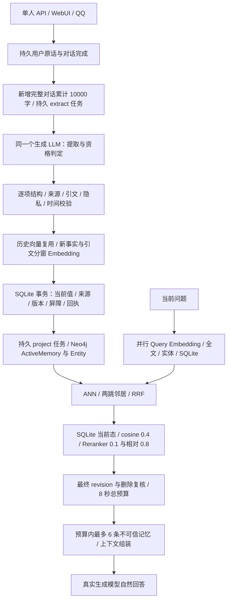

# Mneme 真实模型长期记忆测试与修复（2026-10-18）

本轮保留 [上一轮架构审查与 100/1000/10000 条压测的修复](memory-2026-10-17.md)，按审查、建立基线、渐进负载、定位、修改、回归顺序继续。开始时备份了 24 个既有修改文件及 SHA256，位于 `artifacts/memory-round2-start.{tar.gz,json}`。本轮没有读取 `.env`、打开真实用户数据库、改动生产记忆、迁移或部署生产服务。

先运行经授权下载的免费离线生成模型；真实语义质量不足后，按用户随后明确授权使用官方 DeepSeek Flash，**全部付费请求共用原来的 5 元上限**。不存在未授权付费调用。密钥通过隐藏终端输入，仅由临时 Relay 进程持有，没有进入配置、代码或账本。

机器可读完整数据见 [JSON 报告](memory-e2e-2026-10-18.json)。报告保留失败与未达标项，不以 HTTP 200 或测试函数退出成功认定质量通过。

## 架构与实际调用链



SQLite 是事实源，Neo4j 是可重建投影；没有新建提取服务或替换技术栈。“小模型判定”并非现有独立阶段：资格判定随提取在同一次生成请求完成，不能虚构独立耗时。后台任务沿用领取、重启恢复、指数退避与最多 8 次失败上限。SQLite 连接池最多 4 个；模型服务 1 个工作线程、16 个排队项；没有持有跨网络的写事务。

真实链通过 App/Store、worker、recall、chat::build_context 与生成客户端贯通，未将整个生产HTTP聊天路由作为负载入口。来源对话保留最近两轮自然生成回复；最终回忆阶段清空聊天历史，私有答案只能由实际召回提供。

这是单人应用，不同聊天 session 共用一个个人记忆。隔离测试使用独立 App/SQLite；不能据此宣称已支持同一实例内多租户。删除 API 的屏障、旧队列阻断及跨实例污染在回归中验证；本轮真实生成金标主要验证“不保存”。**自然语言删除意图自动执行不是当前已实现的功能**，不能以提取器忽略删除语句代替真正删除 API。

## 数据、模型与评分

原始金标 `tests/fixtures/memory/e2e.json` 在推理前冻结：两份各 18 轮、跨 84/86 天的自然对话，22 次事实写入/变更、14 次应跳过，最终各 7 个当前事实，另有 20 个查询。新增书店集 13 轮/8 问题，包含职业、素食、预算、母亲、退休、持续性演讲紧张及应对计划；展馆确认集 10 轮/8 问题，包含换岗、通勤方式变化、亲属职业和口味。后两集在各自第一次推理前定义，但后续已用于故障诊断，不能继续称为完全未见过的盲测集。

最终三个生成集共 59 轮原话、36 个独立回忆问题、40 个应写事实/更新束、25 个最终事实束。每轮保存实际写入正文和当前状态快照，另有 24 个来源的真实自动批处理与重叠回放、18 条并发完整链，以及 52 个固定语义检索问题、720 次真实本地检索负载。样本量有限，不能外推为数月真实用户成功率。

写入 Precision 按有效相关条目、Recall 按完整金标事实束计数。复合事实可拆成多条原子记忆，全部子句满足才得 Recall；正文完整但拆条不视为错误。`e2e-compositions.json` 只进入评分器，未进入运行时或提示词。重复另按规范正文统计。检索 FP 计算注入的不相关条目；任务失败后的空写入不能算成功跳过。最终状态独立检查旧值、额外事实、遗漏与重复。

回答提供最低词义锚点分数、实际检索支撑分数和逐条语义人工复核；审计文件绑定原始 `results.json` SHA256。旧值处于明确否定/过去时不当作错误；泛泛建议偶然出现正确关键词也不当作成功回忆。自动评分对未列入金标但有依据的额外事实可能偏严，相关个案保留并说明，不改金标追求通过。

基线使用本轮开始时的冻结评估二进制及校验清单 `artifacts/memory-e2e-baseline-bin.json`，已包含上一轮修复；不是未修改的 Git HEAD。初始 Rust 源聚合 SHA256：`20414d75b1dba2bf8dcec4d332680d729992c0f34a9c3c4368568115eb8e2a5b`；最终：`e194383a0f9fd3e4cf84909a49131280b10b5c5a7e6e0c9ee568806e85653aac`。各运行另记录源文件、Python 模型服务、依赖与金标逐文件指纹。

同模型前后对照均为官方 `deepseek-flash`、禁用 thinking、temperature=0、相同输入与默认 FP32 Embedding/Reranker。官方别名可能变动，不能固定其私有权重或保证位级复现。DeepSeek 不支持此处所需的 `json_schema`，测试使用 JSON object 格式；可选 Schema 只用于支持的本地服务。模型目录和接口以 [官方文档](https://api-docs.deepseek.com/api/create-chat-completion) 为准。

本地运行器 llama.cpp b11669；Qwen3-0.6B Q8_0 与 Qwen2.5-1.5B Instruct Q4_K_M 的下载 revision、SHA256 在 `artifacts/memory-e2e-runtime/manifest.json` 和运行器中固定；4B 权重已准备但未推理，不计作已测试。原有 Embedding 为 Qwen3-Embedding-0.6B `97b0c614be4d77ee51c0cef4e5f07c00f9eb65b3`；Reranker 为 gte-multilingual-reranker-base `8215cf04918ba6f7b6a62bb44238ce2953d8831c`；均离线只读加载。

## 真实质量结果

| 运行 | 原话 / 问题 | 写入 P / R | 完成且内容正确 | 检索 P / R | 集合全对 | 最终事实 | 质量门槛 |
|---|---|---|---|---|---|---|---|
| 同模型 FP32 修复前 | 36 / 20 | 95.7% / 100.0% | 35/36 | 86.7% / 92.9% | 17/20 | 14/14，额外 1 | False |
| 同模型 FP32 最终 | 36 / 20 | 100.0% / 100.0% | 36/36 | 100.0% / 100.0% | 20/20 | 14/14，额外 0 | True |
| 新增书店主题，FP32 | 13 / 8 | 100.0% / 100.0% | 13/13 | 100.0% / 50.0% | 5/8 | 6/6，额外 0 | False |
| 新增展馆主题，FP32 | 10 / 8 | 100.0% / 87.5% | 9/10 | 80.0% / 60.0% | 5/8 | 5/5，额外 0 | False |

| 运行 | 最低词义锚点 | 人工事实复核 | 有检索支撑的人工复核 |
|---|---|---|---|
| FP32基线 | 17/20 | 19/20 | 19/20 |
| FP32最终 | 20/20 | 20/20 | 20/20 |
| 新增书店 | 6/8 | 5/8 | 5/8 |
| 新增展馆 | 7/8 | 6/8 | 6/8 |

自动词义锚点有漏判和偶然命中，人工事实评分也不等同风格或完整性满分；短基准输出预算可能截断长建议，见审计理由。

“额外”是严格金标差异，不自动等同虚假记忆；通过率与任务完成分开列。59轮全部提交正文另逐条核对人物、否定、时序与数值，审计在各运行的 `memory-content-audit.json`，绑定结果SHA。类别表表示输入场景的正文判定；未独立评估 `kind` 枚举的混淆矩阵。完整原话分类统计如下。

| 类别 | 轮数 | 内容全对 | 应写事实 TP / FN | 额外条目 FP |
|---|---|---|---|---|
| budget | 1 | 1 | 1 / 0 | 0 |
| chitchat | 3 | 3 | 0 / 0 | 0 |
| commute | 1 | 1 | 1 / 0 | 0 |
| commute_update | 1 | 1 | 1 / 0 | 0 |
| diet | 1 | 1 | 1 / 0 | 0 |
| ephemeral_emotion | 2 | 2 | 0 / 0 | 0 |
| hypothetical | 4 | 4 | 0 / 0 | 0 |
| hypothetical_other | 2 | 2 | 0 / 0 | 0 |
| negation | 2 | 2 | 2 / 0 | 0 |
| no_save | 4 | 4 | 0 / 0 | 0 |
| numeric_paraphrase | 1 | 1 | 1 / 0 | 0 |
| numeric_update | 1 | 1 | 1 / 0 | 0 |
| occupation | 2 | 2 | 2 / 0 | 0 |
| occupation_update | 2 | 2 | 2 / 0 | 0 |
| paraphrase_duplicate | 2 | 2 | 2 / 0 | 0 |
| pet | 2 | 2 | 2 / 0 | 0 |
| preference | 3 | 3 | 3 / 0 | 0 |
| preference_update | 2 | 2 | 2 / 0 | 0 |
| quotation | 4 | 4 | 0 / 0 | 0 |
| relationship | 4 | 4 | 6 / 0 | 0 |
| repeat_commute | 1 | 0 | 0 / 1 | 0 |
| repeat_fact | 2 | 2 | 2 / 0 | 0 |
| repeat_occupation | 1 | 1 | 1 / 0 | 0 |
| stable_emotion | 1 | 1 | 1 / 0 | 0 |
| stable_fact | 2 | 2 | 2 / 0 | 0 |
| stable_hobby | 2 | 2 | 2 / 0 | 0 |
| temporal_update | 2 | 2 | 2 / 0 | 0 |
| temporary_event | 2 | 2 | 0 / 0 | 0 |
| third_party_fact | 2 | 2 | 2 / 0 | 0 |

最终演化快照：主集 36/36 全对，书店集 13/13，展馆集 10/10；完整 TP/FP 见 JSON。这些快照检查每个时点的当前值，不只检查最后一次结果。

实际失败问题与回答：

- 书店新增集：`我现在在哪里工作，具体做什么？`；期望 ['occupation']；实际正文 []。回答：我这边没有关于你工作单位或具体职责的记录，所以没法准确回答。你可以直接告诉我，我就能接着聊；如果之前提过但换了工作，也以你现在说的为准。
- 书店新增集：`按我一直以来的饮食习惯，聚餐选菜要注意什么？`；期望 ['diet']；实际正文 []。回答：我这边没有你以往饮食习惯的具体记录，所以没法直接说“你一直怎样”。不过可以给你一个实用的选菜思路，你对照自己的情况筛一下：

**先定几个硬约束**
- 有没有忌口/过敏（海鲜、花生、乳制品、麸质等）
- 有没有在控制的东西（油、盐、糖、辣、酒精）
- 肠胃是否敏感（生冷、辛辣、油腻容易不舒服）

**点菜时的通用平衡**
- 荤素比例大概 1:2，别整桌都是硬菜
- 至少一道清蒸/白灼/炖煮的，少一道油炸和重口
- 主食别省，聚餐容易只吃菜不吃主食，反而后面饿
- 汤选清汤，浓汤和勾芡多的热量高

**聚餐场景特有的**
- 先吃几口蔬菜和主食垫一下，别空腹直接上酒和重口菜
- 分餐或公筷，尤其有生食的桌
- 饮料优先白水/茶，甜饮和酒按自己酒量来，别被劝着走
- 书店新增集：`我妈妈叫什么名字，她还在工作吗？`；期望 ['mother_name', 'mother_retired']；实际正文 ['用户的妈妈叫陈素。']。回答：你妈妈叫陈素。

至于她是否还在工作，我这边没有相关信息，没法确定。你可以直接问问她，或者告诉我更多情况，我再帮你一起理一理。
- 展馆确认集：`我现在的工作地点和岗位是什么？`；期望 ['occupation']；实际正文 []。回答：我这边没有关于你工作地点和岗位的记录，所以没法直接回答。你可以告诉我，我记下来，之后聊到相关的事会更顺一些。
- 展馆确认集：`我每天上下班通常怎么走？`；期望 ['commute']；实际正文 []。回答：我这边没有你日常通勤路线的记录，所以没法说出你通常怎么走。你可以告诉我起点和终点（比如家到公司大概在哪个区域、偏好地铁还是开车），我可以帮你一起梳理路线或比较几种走法。
- 展馆确认集：`孟川住哪里，做什么工作？`；期望 ['cousin_job']；实际正文 ['用户的表哥孟川住在洛阳。', '用户的表哥孟川是园林工程师。', '用户的表哥叫孟川。']。回答：你表哥孟川住在洛阳，是园林工程师。

独立种子检索的 52 问题：TP 42 / FP 2 / FN 1，Precision 95.5%，Recall 97.7%，49/52 集合全对。仍会把“谢谢你，晚安”与作息联系，把还书计划与买书预算联系；伴侣攀岩问题缺少关系桥接项。未据这些文本加入查询规则。

免费本地生成能力与代码收益分开：1.5B 修复前 36 轮写入 P/R=18.2%/9.1%，同一模型中间开发集 18 轮为66.7%/36.4%，仍不达标；后者不是完整配对对照。0.6B 原实现开发集仅1/18任务完成，Schema 合法不代表语义正确。DeepSeek 的质量提升不能全算作代码优化。

## 实际缺陷、根因与保留修复

1. **已完成推理响应仍超时**：真实模型出现45秒提取 Embedding 超时和8秒召回超时，但 CPU 推理已完成且无排队。根因是 Starlette `is_disconnected()` 的取消作用域偶发吞掉监听任务取消，响应在 `submit` 清理阶段等待不退出。改为请求体解析后直接等待 ASGI disconnect。相同取消竞态回归旧实现失败、新实现通过；真实 TCP 断连仍取消排队任务。证据 `artifacts/memory-disconnect-{before,after,fixed}.log`。
2. **批处理静默漏记**：真实模型输出中文属性键，整条来源候选被拒绝；其他来源有效使整批提交，旧实现却给全部来源写成功回执。原批测试每个档案只有4/6最终事实却12/12回执。修复逐来源追踪拒绝、仅对没有有效候选的失败来源生成有界独立重试，事务内同时提交有效来源、删除批任务、安排重试。提示明确 ASCII 键；增加实际 SQLite/worker 回归，防止“接口成功即没漏记”。
3. **任一坏项拖垮所有候选**：先逐条结构、来源、逐字引用和策略校验，再检查有效项的重复槽位；歧义重复全部拒绝，不依赖输出顺序。非空响应全部无效仍失败重试。批来源伪造仍不能提交。
4. **错误证据强化旧事实**：提示中的具体住址示例被0.6B复制，历史也被当成本轮事实；移除事实示例，明确当前原话的证据边界，以来源语义筛选最多8项历史索引。事实和引文分窗向量 cosine 默认至少0.5；18组正校准最低0.6475，两类真实无关证据约0.289/0.291。合并事实和引用 Embedding，复用已知向量。此门槛不能证明否定、数字或时间上的逻辑蕴含。
5. **等价提示覆盖新值与确认遗漏**：只接受相同槽位、相同规范正文的等价提示，错误 id 清空而保留新事实独立验证；避免模型把旧内容替换回更正。当前提示的“无新事实”规则与等价确认存在歧义，本轮未取得可靠的通用修复。曾强调重申的实验出现历史属性重复确认与附带否认保存，已主动停止并撤回；`memory-deepseek-completed-main` 为部分失败产物；随后较小提示改写的 `memory-deepseek-delivery-main` 完整36轮写入P降为92%，也撤回。两组未与最终采用版本混算。重申观察时间的可靠刷新仍有不足。已提取来源在调用模型前确认退出，减少重叠批任务的重复调用。
6. **属性键随值漂移**：确认集曾同时保留“骑车通勤”和“地铁通勤”，分别使用值相关键。加强主体/属性维度与旧键复用要求，即使旧键含旧值也必须沿用。此项仍依赖模型遵循提示，未引入按样本命名的归一化映射，无法保证任意旧键都自动归并。
7. **无关尾部进入上下文**：保留独立 cosine 0.4 和精排0.1，增加相对于最佳精排分数0.8的尾部过滤，可配置关闭。保持8秒总预算、最终 revision/删除复核、降级空结果。放宽 cosine、人称回退、加权融合和保留最强向量等实验虽提高部分新主题 Recall，却在完整语料增加误召回，已撤回；失败产物保留，未按问题文本硬编码。
8. **自然回忆主体与语气**：明确记忆中的用户即当前人，使用第二人称；相关时自然回答，不默认质疑全部历史或编造共同经历。最终主集回答已逐条复核；仍可能出现“根据记录”式措辞、未经核验的季节天气概括或多余反问，不能把私有事实评分称作自然度满分。
9. **可选模型格式/精度及观测**：`llm.json_schema` 默认 false，支持者可启用严格结构；新增事务与阶段指标、超时阶段名称，不修改接口契约。两个 dtype 默认均 FP32。Embedding 可显式启用 BF16，归一化仍FP32；Reranker 保持FP32。实际全BF16边界分数改变筛选结果，未设默认，也未迁移生产向量。
10. **连接与预算恢复**：模型 HTTP 客户端不保留空闲连接，黑洞 keepalive 同一回归旧失败新通过；这不是上面取消竞态的根因。Relay 在进程意外退出后从原账本恢复累计费用，未知请求预留按全额计费，禁止重置预算及双进程拥有账本，补充恢复预算回归。

| 档案 | 旧最终 TP / FP | 新最终 TP / FP | 新回执 / 来源 | 自动批任务 | 新 pending/running/dead |
|---|---|---|---|---|---|
| dev-lin | 4/6 / 0 | 6/6 / 0 | 12/12 | 3 | {'pending': 0, 'running': 0, 'dead': 0} |
| heldout-qi | 4/6 / 0 | 6/6 / 0 | 12/12 | 4 | {'pending': 0, 'running': 0, 'dead': 0} |

批处理修复前后原始结果在 JSON 中逐档案列出，最终来源回执、事实正文、自动任务数和死信须一起核对。仅修复某来源全部无效时的静默确认；同一来源部分有效、部分漏项仍有局限。既有已被错误确认的旧回执不会被本轮自动重写；历史漏项如需修复，须另行授权后按原始来源审查并回放。

## 延迟、负载与资源

宿主机4 CPU、约7.7 GiB RAM，无GPU；Rust test profile，未将结果称作 release SLA。Neo4j 独立 tmpfs，heap512 MiB、page cache64 MiB、容器1536 MiB；E2E模型容器4 GiB、CPU3、推理线程2，检索专测容器3 GiB。模型API远端CPU/GPU/RAM不可观测；表中资源只包含本地Embedding/Reranker、Neo4j及Relay。

| 阶段，ms（P50 / P95 / P99） | FP32 修复前 | FP32 最终 |
|---|---|---|
| 单原话后台提取至投影，含轮询 | 1862.7 / 3403.2 / 6661.3 | 2277.5 / 3514.3 / 5140.2 |
| 生成模型提取与资格判定 | 1039.8 / 1298.6 / 1608.6 | 1059.1 / 1554.5 / 1750.2 |
| 提取上下文/事实/证据 Embedding RPC | — | 224.2 / 355.4 / 1620.7 |
| SQLite 提交事务 | — | 2.7 / 5.2 / 5.8 |
| Neo4j 投影/维护 RPC | — | 28.1 / 247.8 / 1195.1 |
| 完整记忆检索 | 641.4 / 1409.8 / 8002.3 | 481.8 / 607.4 / 859.8 |
| 检索 Embedding | 490.7 / 636.1 / 662.1 | 372.5 / 440.0 / 448.7 |
| Reranker | 120.2 / 183.7 / 416.1 | 96.2 / 169.7 / 177.3 |
| 上下文组装 | 2.2 / 3.4 / 3.6 | 2.1 / 2.9 / 3.3 |
| 自然回答生成 | 1091.9 / 1419.3 / 1670.1 | 1079.1 / 1912.8 / 2084.7 |

基线不存在的事务指标以“—”表示。写入后增加引文证据校验存在额外编码成本，不声称所有阶段都变快。后台时间含1秒测试轮询和投影；RPC时间包含网络/排队，Neo4j维护RPC不是单条查询纯执行时间。API时延存在网络及服务端抖动；P99样本少，提供原始值供复核。

| 本地资源 | FP32 修复前 | FP32 最终 |
|---|---|---|
| models | 3466.6 MiB / 117.5% CPU | 3457.1 MiB / 111.0% CPU |
| neo4j | 526.9 MiB / 82.3% CPU | 590.5 MiB / 80.9% CPU |
| Relay RSS | 50.7 MiB | 66.0 MiB |
| 最低宿主可用内存 | 1001.7 MiB | 1413.4 MiB |

CPU百分比按单核100%计；监测约每秒一次。宿主已有swap，变化不等于本进程泄漏；未执行数小时泄漏测试。SQLite池上限4；未采样远端DB活跃连接或远端生成资源，不能虚构连接曲线。Neo4j唯一索引、ActiveMemory向量/全文和实体种子UNWIND索引定位沿用上一轮，EXPLAIN证据在上一轮报告。

以下完整链为“生成自然回复 → 提取/写入/投影 → 检索 → 再生成回答”，每格6个独立档案，模型服务与Neo4j共享。付费生成并发只渐进到5；Embedding BF16、Reranker FP32，前后相同精度。生产记忆提取异步运行，这里的链耗时不等于前台聊天HTTP请求延迟。外部API抖动和单次小样本不能支持普遍加速倍数。

| 并发 | 链数 | 旧链延迟 P50/P95/P99 ms | 新链延迟 P50/P95/P99 ms | 吞吐 RPS | 内容及回答正确 | 降级 |
|---|---|---|---|---|---|---|
| 1 | 6 | 3863.4 / 5332.1 / 5332.1 | 4051.4 / 4897.2 / 4897.2 | 0.240 → 0.241 | 6 → 6 | 0 → 0 |
| 2 | 6 | 3359.4 / 4257.2 / 4257.2 | 3600.7 / 3935.8 / 3935.8 | 0.551 → 0.540 | 6 → 6 | 0 → 0 |
| 5 | 6 | 4006.6 / 11667.3 / 11667.3 | 3654.9 / 4125.3 / 4125.3 | 0.399 → 0.905 | 5 → 6 | 1 → 0 |

真实本地模型的720次检索如下；不是720次付费生成。该运行使用最终检索实现；之后提取提示的实验均撤回，五组E2E运行全部构建指纹与当前采用版本一致。42条文档向量从同一合成语料的FP32导出并导入，检验BF16查询与现有向量兼容，不重新编码生产数据。

| 输入 | 并发 | 请求 | P50/P95/P99 ms | RPS | 降级 | P / R | 集合全对 |
|---|---|---|---|---|---|---|---|
| repeated_queries | 1 | 120 | 34.7 / 49.9 / 67.1 | 27.60 | 0 | 96.3% / 100.0% | 116 |
| repeated_queries | 5 | 120 | 90.4 / 172.8 / 194.7 | 49.84 | 0 | 96.3% / 100.0% | 116 |
| repeated_queries | 20 | 120 | 186.7 / 352.2 / 399.1 | 96.01 | 0 | 96.3% / 100.0% | 116 |
| repeated_queries | 50 | 120 | 372.5 / 522.1 / 612.7 | 117.86 | 0 | 96.3% / 100.0% | 116 |
| distinct_query_inputs | 1 | 120 | 317.3 / 444.0 / 611.7 | 3.11 | 0 | 92.6% / 96.2% | 108 |
| distinct_query_inputs | 50 | 120 | 146.2 / 5011.4 / 5670.8 | 19.59 | 103 | 100.0% / 18.3% | 41 |

完整并发链运行（Embedding BF16/Reranker FP32）的本地峰值：模型 1781.5 MiB、CPU 84.1%；Neo4j 590.4 MiB、CPU 98.7%。这是整次运行采样峰值，不是每个并发格独立峰值；各并发分阶段延迟另存机器报告。

50个不同输入超过单CPU worker与16项等待队列，出现大量降级。空结果很快完成会抬高RPS，必须同时看Recall/降级，不能视为有效吞吐提升。缓存命中吞吐不能代替冷输入能力。

100/1000/10000 × 1/5/20/50 的1440次检索和2880次写入矩阵保留在上一轮报告；10k/50下协议+真实Neo4j P95为4248.8→1339.7ms、RPS14.0→42.6。它使用确定性模型和合成向量，**不是本轮真实生成模型的10k语义结果**。本轮没有付费生成10k条数据，也未用100%协议通过率推断大规模语义准确率。

## 回归、安全与复现

最终Rust常规测试73通过，7项需外部模型/服务的显式测试默认忽略；相关真实项由上述隔离运行器单独运行。严格Clippy、rustfmt、git diff检查通过。Python38项中32通过、6项模型服务依赖测试在宿主跳过，后者在实际模型镜像内6/6通过。Node宿主10通过/2跳过；实际工具镜像内12/12通过，包含真实沙箱Chromium。聊天、SSE、跨轮历史、搜索协议、图片消息/顺序/隔离、200次工具编排、重启恢复和删除竞态均在回归范围；没有把文本模型测成真实视觉理解验收，也没有调用付费搜索API。

脚本只接受临时端口与本次标记，拒绝已占用端口；只移除本次成功创建的随机容器。SQLite均为临时目录；镜像 `--pull=never`，固定权重只读、HF离线。监控低于约350 MiB宿主可用内存时停止E2E，避免一次大量模型请求。原样日志都是合成对话；账本只含用量、状态、时延、价格，不含密钥或提示词。

```bash
# 默认离线；首次权重下载须已获授权，日常评估不加下载参数。
python3 scripts/memory-e2e.py --download-free-model --prepare-only \
  --generation-model qwen2.5-1.5b --output artifacts/free-prepare
python3 scripts/memory-e2e.py --generation-model qwen2.5-1.5b \
  --output artifacts/free-replay

# 付费复测必须有新的明确预算授权。密钥只在隐藏提示中输入。
python3 scripts/memory-deepseek-relay.py --budget-cny 5 \
  --ledger artifacts/authorized-budget.json
# 同一授权意外中断：使用原账本加 --resume，禁止另开5元预算。
# 在另一个终端，顺序运行；默认为 FP32，不碰生产配置。
python3 scripts/memory-e2e.py --deepseek-relay --split all \
  --require-quality --output artifacts/replay-main
python3 scripts/memory-e2e.py --deepseek-relay --split unseen \
  --require-quality --output artifacts/replay-unseen
python3 scripts/memory-e2e.py --deepseek-relay --split confirm \
  --require-quality --output artifacts/replay-confirm
python3 scripts/memory-e2e.py --deepseek-relay --test real_local_batch \
  --output artifacts/replay-batch
python3 scripts/memory-e2e.py --deepseek-relay --test real_local_load \
  --cpu-dtype bfloat16 --rerank-dtype float32 --output artifacts/replay-load
# 结束后 Ctrl-C 停止Relay，并撤销一次性密钥。

# 不调用聊天API：真实离线检索和渐进负载。
python3 scripts/memory-eval.py --mode semantic \
  --model-cache-volume mneme-model-cache --real-model-load \
  --output artifacts/semantic-replay
# 纯协议+真实数据库的大规模矩阵，不调用聊天API。
python3 scripts/memory-eval.py --mode load --output artifacts/matrix-replay
python3 scripts/memory-e2e-report.py artifacts/replay-main \
  artifacts/replay-unseen artifacts/replay-confirm --output artifacts/quality.json

CARGO_PROFILE_DEV_DEBUG=0 CARGO_PROFILE_TEST_DEBUG=0 CARGO_INCREMENTAL=0 cargo test --all-targets
CARGO_PROFILE_DEV_DEBUG=0 CARGO_PROFILE_TEST_DEBUG=0 CARGO_INCREMENTAL=0 cargo clippy --all-targets -- -D warnings
cargo fmt --all -- --check
python3 -m unittest discover -s tests -p 'test_*.py'
node --test services/tools/test/*.test.mjs
```
`--require-quality` 会在质量不足时返回非零；探索运行保留失败以完成诊断，省略该开关时退出0仅说明运行完成。全套脚本、金标和回归均随代码保留；运行器不会自动提交代码或部署生产服务。

| 运行 | 原始证据目录 |
|---|---|
| memory-deepseek-baseline | `artifacts/memory-deepseek-baseline/` |
| memory-deepseek-accepted-fp32 | `artifacts/memory-deepseek-accepted-fp32/` |
| memory-deepseek-accepted-unseen | `artifacts/memory-deepseek-accepted-unseen/` |
| memory-deepseek-accepted-confirm | `artifacts/memory-deepseek-accepted-confirm/` |
| memory-deepseek-accepted-batch | `artifacts/memory-deepseek-accepted-batch/` |
| memory-deepseek-accepted-load | `artifacts/memory-deepseek-accepted-load/` |
| memory-accepted-semantic | `artifacts/memory-accepted-semantic/` |

费用账本 `artifacts/memory-deepseek-budget.json`：累计 1249 个付费请求，峰值未命中价保守上界 **1.685060 元**，未结预留 0.000000000 元，低于5元授权。按本次周日非高峰及cache用量估算约 0.624641 元；这不是账单金额，未查账户账单。价格依据 [DeepSeek官方价目](https://api-docs.deepseek.com/zh-cn/quick_start/pricing/)，中继用更高峰值价预留，未知用量保留全额。

## 尚存限制

新职业/饮食问题会因编码主体和表达差异漏召回；复合问句的相关条目会被相对门槛截断，不能为了这些Recall损失重新引入大量不相关个人事实。标准答案覆盖有限，真实环境存在更多隐含、反讽、罕见关系和长距离更新。显式长期记忆删除不自动抹除原始聊天历史，不能当作所有数据的擦除。当前引文cosine并非蕴含判定器；长期更新仍依赖模型选择相同属性键，来源最近64项筛选也可能漏掉更早属性。无需重构的修复已落实，更广泛的语义归并仍需新盲测支持。

独立来源部分漏项、语义等价改写新建版本、历史失效内容不能作为当前事实召回、队列1/16带来的冷输入并发上限、多租户缺失、自然语言自动删除缺失、远端资源不可观测、长时间泄漏和10k真实向量质量未测，都不能宣布已解决。所有失败案例、撤回实验和评分口径保留；本报告不作为生产迁移或上线批准。

交付复核：159个变更/证据文本文件未发现密钥格式字符串，起始24个既有变更文件均保留。原始证据打包在 `artifacts/memory-e2e-delivery.tar.gz`，校验清单 `artifacts/memory-e2e-delivery-manifest.json`。临时Relay和全部本轮测试容器已停止；未修改生产配置。
