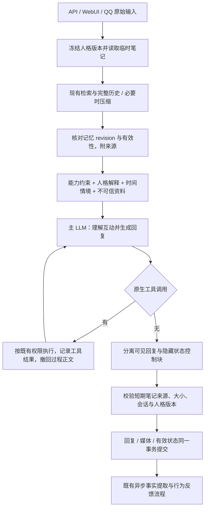

人格优先改造与对话验收（2026-10-21）

本次从 `784a78a` 审查 API/WebUI/QQ、System Prompt、人格画像与进化、历史压缩、记忆检索/注入、LLM 流式协议、工具循环和最终保存。改造已落在工作区；没有部署或改动生产数据库。结论是：人格现在参与互动理解与选择，短期互动有了独立、受证据约束的保存路径，工具过程不再自动成为正式历史。但真实模型的自然度、状态更新意愿和成本目标尚不能宣布全面通过。

旧实现已经有可编辑人格画像、受限行为进化和长期事实记忆，不是完全缺少人格。本次复用了这些能力。没有发现代码硬性要求每轮“分析→建议→人格化结尾”；实际干扰来自以下机制。

| 机制 | 原实现的影响 | 本次变化 |
| --- | --- | --- |
| 人格与问答规则混排 | 抽象人格与大量始终生效的个人事实规则并列，缺少互动选择的职责划分 | 将能力底线、人格解释、互动原则分层；人格负责注意、理解、态度、主动性与表达，真实性和权限仍约束全部行为 |
| 只有历史/摘要和慢速习惯进化 | 当前关注、待续话题和刚发生的误解没有独立的短期归属 | 同一次回复携带轻量互动笔记，与事实记忆、人格习惯分开提交 |
| 历史发送时间未进入主上下文 | 知道“现在”，却无法确定旧消息中“明天”的日期 | 每条保留历史带本地时间；当前情境单独提供时区、时钟与消息时间；压缩要求保留日期锚点 |
| 记忆只有加工后的断言 | 缺少类型、来源性质与限定原话；更新时间易被误作事件时间 | 注入 kind、origin、有界来源摘录和真实来源时间，将记录更新时间明确命名为 record_updated_at |
| 累加全部工具轮正文 | 工具前导语、重复承诺与最终答案混存，下一轮继续模仿 | 只保存结束循环的答复；工具调用/收尾重试发 reply_reset，过程文字可单独作为 tool_progress |
| 空记忆库也运行检索 | 寒暄仍触发无收益的模型/图谱请求 | SQLite 没有可用记忆时直接略过检索，不增加意图分类器 |

当前主链路如下。普通无工具对话仍只有一次主生成；人格编译、受限行为进化和必要压缩沿用原来的触发方式。

实现主要在 [chat.rs](../../src/chat.rs)、[interaction.rs](../../src/interaction.rs)、[continuity.rs](../../src/continuity.rs)、[llm.rs](../../src/llm.rs) 和 [store.rs](../../src/store.rs)。原始 Persona 五字段保留；人格画像编译器升为 v6，增加对注意、含糊意图、立场、主动性取舍的推导要求，不引入少女、傲娇等角色类别。原有六维画像是可编辑倾向，不是路由表；旧画像因编译版本变化而待更新，原始人格继续生效。既有锁定、证据、版本回退和受限自修改路径保留。

临时状态是 focus、stance、open_thread、correction 四个可空的自由文本条目，没有情绪分数、固定台词或状态转移机。每条附真实消息引用；模型使用短消息标识，服务端核对唯一来源并恢复完整 ID，歧义引用拒绝。每项解释和引文各最多 80 字，完整候选按本地分词最多 320 Token。状态只以不可信资料进入上下文，不能成为用户事实、执行授权或系统指令。

正常正文末尾的隐藏控制块由流式解析器移除：null 表示不更新；对象表示完整替换，可以清空已结束或被纠正的项目。格式、证据、跨会话引用或大小不合格时丢弃更新，保留有效正文；只有状态、没有正文或媒体的输出不能提交。回复失败时不保存状态。状态与回复原子提交，重启可恢复，24 小时后或人格/画像基础变化时失效。严格输出格式配置下不要求该控制块，继续通过历史与摘要承接。逐字引用能验证来源，不能证明解释必然符合原话，因此笔记始终不升级为事实。

WebUI 复用现有人格画像编辑、锁定与预览入口，并增加“临时互动状态”面板，显示内容和引文、刷新、清除；正在生成时拒绝清除，避免旧请求随后复活笔记。预览不保存状态。`GET/DELETE /v1/console/persona/state` 使用现有认证；新增迁移 [0013](../../migrations/0013_interaction_state.sql) 只创建状态表，不改旧迁移或重写原有对话、记忆。

工具 SSE 客户端需处理 reply_reset；WebUI 已支持，终端客户端等待提交后输出正文。QQ 使用生成函数返回的正式答复。工具过程与推理仍可用于本轮工具协议，但不自动进入长期对话正文。执行、审计、调用上限、外部操作授权及 self_prompt 的受限反思机制没有放宽。

真实验收使用用户提供凭证的 `deepseek-flash`，基线为原提交单独构建的二进制；所有消息、人格、数据库都是隔离的合成数据，QQ 关闭。两个人格分别偏沉静/留白和外向/线索收束，它们只是测试配置，不进入产品默认策略。检索基础设施和浏览器内容使用本地确定性替身，生成模型是真实供应商，因此本次不能据此评价真实 Embedding/Reranker 的语义质量或真实网站访问。

可重跑脚本为 [persona-dialogue-eval.py](../../scripts/persona-dialogue-eval.py)，凭证通过私有文件读取，结果不含凭证。原始请求、回复、用量、SQLite 与二进制摘要留在被 Git 忽略的 `artifacts/personality-first/`。首次配对结果（历史元数据隔离修复前）在 `deepseek/results.json`，早期迭代另存 v1/v2/v3，不混作最终效果。

| 场景 | 首次配对观察 |
| --- | --- |
| 日常闲聊 | 两版都能接猫与落叶的具体分享；新版也能停在短回应，没有证据证明所有闲聊自然度都提升 |
| 知识问答 | 两版正确解释 Python 默认可变参数并给 None 修复；6×7 的正式回复均为 42 |
| 前后矛盾 | 两版均采用本轮更正：现在杭州、以前苏州，不强行以旧资料覆盖 |
| 时间误解与自我纠错 | 原版缺历史日期，无法确定旧“明天”；新版按 10 月 19 日的原消息正确算出 10 月 20 日。它仍曾暗示计划已经发生；用户纠正后自然承接，并保存“计划不等于已发生”的有来源修正 |
| 情绪交流 | 两版大多不输出分析清单；新版产生并延续“不分析或建议”的互动关注。轻度劝慰仍可能带建议意味，不算完全解决 |
| 记忆延续 | 两版从注入的手动记忆答出项目名“纸桥”，理解加副标题不等于改名；未知宠物名没有猜。未验证真实提取和语义检索服务的端到端质量 |
| 人格一致性 | 不同人格对故事结局有不同取舍，能在用户持相反偏好时维持观点。新版一轮在 1000 输出 Token 的测试限制内耗尽推理、没有正文；使用项目默认 1200 上限补测后正确完成，不能因此声称预算问题彻底消失 |
| 工具与事实边界 | 两版读取隔离页面并否认未经请求的提交；原版第二轮再次核验并把过程文字累加进答复，新版的正式历史只保留最后答复。没有发生外部提交 |

配对共 56 轮：基线 28/28 提交，新版 27/28 提交；失败轮的部分内容和状态均未提交，另有一次默认预算补测成功。两个人格各实际生成一份通过原话证据校验的六维画像，并各做三次独立预览；预览结束后 messages、memories、interaction_state 均为 0。最终状态真实样本覆盖误解修正与情绪互动关注；关注/态度/待续话题的完整结构、空更新和清除另有协议回归，不把确定性替身冒充真实自然度证据。

| 同一配对集的成本指标 | 基线 | 新版 |
| --- | ---: | ---: |
| 主聊天请求数，含工具续轮 | 30 | 30 |
| 每次请求 API 输入 Token 中位数 | 673.5 | 871.5 |
| 每次请求 API 输出 Token 中位数，含思考 | 145.5 | 231.5 |
| 输入 Token 合计 | 25,345 | 30,589 |
| 输出 Token 合计，含失败轮思考 | 5,044 | 8,770 |
| 整轮耗时中位数 | 1.963 秒 | 2.530 秒 |
| 本地估算的 system Token 中位数 | 729 | 709 |

新版没有新增逐轮分类、规划或回复改写调用；成本仍增加，来源包括时间/来源元数据、状态输出及模型思考。短引用和精简控制协议已经减少输入，但本次数据不足以把耗时波动全部归因于架构，更不能宣布“零开销”或稳定 P95。控制复杂度的调用数目标达到，Token/延迟目标仍需按实际部署负载继续评估。

工程验证：完整 `cargo test` 为 **126 通过、0 失败、12 忽略**；忽略项包括需要独立真实服务或资源的既有测试，不算通过。`cargo clippy --all-targets -- -D warnings`、格式与 JS/Python 语法检查通过。Chromium 桌面和 390px 检查通过，覆盖人格生成/编辑/锁定/预览与失效、状态显示/清除、忙碌冲突及 XSS 转义。新增状态回归覆盖任意 UTF-8 分片、截断/损坏控制块、无正文、错误引文、跨会话与歧义引用、事务保存、失败不提交、重启/过期/人格失效及来源限定。工具回归重建实时可见文本，核对其与保存结果一致，并保留长工具循环与断流故障检查。

仍需明确保留的边界：检索仍以本轮查询为主，省略和代词召回依赖已有历史/摘要，未引入额外改写模型；记忆摘录和状态引用不等于语义蕴含验证；模型可能不生成新的状态或仍出现刻板劝慰；Provider 思考预算会影响完成率。新迁移后的库不能直接交给不认识 0013 的旧二进制。这里交付的是可审查、已测试的架构改造，没有把这些限制写成已经修复。

后续实际人格探针：[傲娇少女 8 轮原文](tsundere-live-2026-10-21.md)。这次发现历史助手正文中的时间/消息标识会被复制进新回复，已将元数据移到独立资料块，保留所有历史正文原文；Token 核算与压缩同步修改并通过完整回归。上述 56 轮成本数据属于此修复前的构建，不能冒充最新构建的重新测量。新探针 8/8 提交，无标识泄漏，但技术回答的人设尾句与“未告知”断言仍是未通过项。

后续模型切换：[Mistral Large 4 八轮原文与失败记录](tsundere-mistral-2026-10-21.md)。补充零温度 top_p 与带类型内容分块兼容；最新回归 127 通过、0 失败、12 忽略，Clippy 通过。默认 1200 输出预算出现失败，提高至 4096 后八轮完成，但延迟、口头禅及状态修正问题仍保留。

后续模型切换：[Grok 4.7 八轮原文](tsundere-grok-2026-10-21.md)。八轮完成，技术回答和未知记忆边界更克制，但没有提交有效临时状态。修复了供应商将正文/思考分计时的输出用量漏算，依显式总数推断口径；用量单元与集成测试、Clippy 通过，未把旧完整回归冒充此次重跑。
